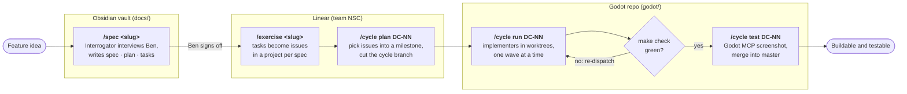

# Midnight Earth

A fresh start, 2026-11-02. The previous repository, with its full history, is archived
read-only at [bknize/midnightearth-archive](https://github.com/bknize/midnightearth-archive).

## Layout

| Path | What |
|---|---|
| `docs/` | Obsidian vault: planning notes, specs, ADRs, systems. Hidden from Godot by `docs/.gdignore` |
| `godot/` | Godot 4.6.3 project (Mobile renderer) |
| `scripts/` | `bootstrap.sh`, `check.sh` (the build gate), hooks, `claude-with-env.sh` |
| `.claude/` | Agents, skills and hooks for the spec-driven dev loop |

## Bootstrap

```bash
scripts/bootstrap.sh   # installs gdtoolkit, checks Godot, creates .env from .env.example
make check             # import → lint → parse → boot → test; exit 0 means buildable and testable
```

Godot 4.6.3 is expected at `/Applications/Godot 4.6.app`; set `GODOT_BIN` to override.
If `make` stops with "You have not agreed to the Xcode license agreements", either accept it
(`sudo xcodebuild -license accept`) or run make through the command-line tools:
`export DEVELOPER_DIR=/Library/Developer/CommandLineTools`. `scripts/check.sh` works either way.
Launch Claude Code through `scripts/claude-with-env.sh` so `.mcp.json` sees the tokens in `.env`.

Work is planned in `docs/specs/<slug>/` and tracked in Linear; see `CLAUDE.md` for the rules.

## How work flows

Every feature goes through the same loop, so agents build against written intent rather
than a vague prompt:



### The orchestrator pattern

"Orchestrator" is a pattern, not a separate tool: the Claude Code session itself, on
Opus 5.5, owns a dev cycle from start to finish. It picks the cycle's issues, dispatches
subagents (`.claude/agents/`) to do the work, and is the only role that tests.

| Role | Model | Does | Never |
|---|---|---|---|
| Orchestrator | Opus 5.5 (the session) | Plans cycles, cuts branches, dispatches implementers, commits and merges, runs `make check` and the Godot MCP, moves Linear issues | Hands testing to a subagent |
| Interrogator | Fable 5.1 | Interviews Ben, writes `spec.md`, `plan.md`, `tasks.md` | Writes code |
| Implementer | Sonnet 5.5 (`implementer-engine`: Opus 5.5 for `godot/engine/`) | Implements one Linear issue in its own worktree | Runs Godot, the game or `make check` |
| Reviewer | Sonnet 5.5 | Ranks findings on a diff before the gate | Edits |

Implementers get no test feedback beyond the PostToolUse hook (gdlint and a parse check
on every saved `.gd`). That keeps the slow, stateful part, running Godot, in one place:
the orchestrator merges each wave onto the cycle branch, runs the gate, and a cycle is
done only when it is buildable and testable.

### The interrogator pattern

Before anything is built, `/spec <slug>` hands the feature to the interrogator. It reads
the planning notes and existing specs, then questions Ben in short rounds of numbered
plain-text questions with lettered options, its recommendation first and costed where
options differ. It stops asking once answers stop changing the design, then writes:

- `spec.md`: requirements as EARS sentences about behaviour, never implementation, with
  every `[NEEDS CLARIFICATION]` resolved before the plan;
- `plan.md`: the approach, checked against `CLAUDE.md` (the constitution);
- `tasks.md`: small, buildable tasks that `/exercise` turns into Linear issues.

The point is to capture intent, constraints and done-criteria up front, so implementers
that cannot run the game still build the right thing.

## Obsidian: the spec vault

`docs/` is an Obsidian vault and the project's long-term memory: planning phases and
their decisions (`docs/planning/`), ADRs (`docs/decisions/`), game-design notes
(`docs/systems/`) and one spec set per feature (`docs/specs/<slug>/`). It is plain
Markdown in git, so agents read and write it as files; Obsidian adds what files alone do
not, for Ben and for the agents:

- `[[wikilinks]]` and maps of content (`*-moc.md`) tie specs, plans and decisions
  together, and the official CLI audits them (`obsidian-cli vault=docs unresolved` and
  `… orphans`) after every writing session.
- Every note has the same frontmatter (`docs/Templates/note.md`), including a stable
  `uid` that Linear issues deep-link to (`obsidian://adv-uri?vault=docs&uid=…`, opened
  by the Advanced URI plugin), so links survive renames.

`docs/.gdignore` hides the vault from Godot, and `docs/.obsidian/` is Ben's editor state,
which agents do not touch.

## Linear: the work tracker

The vault says *what* to build; Linear tracks *who is doing which part, and how far it
has got*. One team (`NSC`) holds a project per spec, a milestone per dev cycle
(`DC-NN <theme>`) and labels `area/*`, `type/*`, `spec/<slug>`. Each issue is one task
from a spec's `tasks.md` and carries a `## Spec` section linking back to the note, both
in Obsidian and on GitHub.

The orchestrator pulls issues through the Linear MCP and moves them as events actually
happen: Backlog → Todo (exercised or picked for a cycle) → In Progress (implementer
dispatched) → In Review (merged onto the cycle branch on a green gate) → Done (cycle
merged into `master`). Subagents have no Linear access; they report to the orchestrator,
which updates Linear. Nothing is pushed from Linear into the repo.
