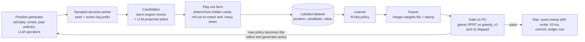

# Bot trainer: an LLM-assisted program on the training PC

> The proposed architecture for a bot-training app on Ben's Windows laptop. It labels positions with scored play-outs, uses a local LLM as a deck operator to propose plans, distils a fast scripted policy from the labels, and is driven from the Mac over MCP on the LAN. Ben's decisions (T1–T8) are at the end; the build goes through `/spec`.

## Why the current loop is not enough

The genetic loop in [[systems/bot-training]] re-weights 13 board-total features. Its first
night (label `tuned-r6-c4cbd3190e297787`, 2026-11-05) produced one candidate in generation 1:
it beat `greedy_v1` (PASS, 0.560) but not the committed weights (FAIL, 0.489). Then fitness
stayed flat between 0.51 and 0.53 for 19 more generations. The run itself was killed from
outside at 16:10 during generation 21 (the `caffeinate` wrapping it died). The flat fitness is
the real finding. None of the features can say "A and B together" or "keep this for turn 6",
so no weighting finds synergies or plans.

The model for the fix is the 2026 Hearthstone Battlegrounds result
([arXiv 2610.33845](https://arxiv.org/html/2610.33845)): a policy built from turn plans
**scored by playing the game out** answered correctly 75% of the time in 0.03 s. The best LLM
playing directly managed 54%, with seconds of reasoning per move. So the LLM does not play the
shipped game. It widens what gets tried, and the play-outs decide what is true.

## The idea in one loop



This is expert iteration without a neural network in the shipped game. Each pass, the
play-outs grade moves better than the current policy can. The next policy learns those grades
and then becomes the rollout policy for the pass after.

## Hardware and what it implies

| Part | Spec | Consequence |
|---|---|---|
| CPU | Ryzen 9 5900HX, 8 cores / 16 threads | Play-out farm: 12 Godot workers, with 4 threads left for the LLM server and the OS |
| GPU | RTX 3070 Laptop, 8 GB GDDR6 | Holds one ~8–9B model at 4-bit (about 5–6 GB) plus its context cache. A 20B model does not fit. The learner can share the GPU between LLM batches. |
| RAM | 16 GB DDR4 | 12 workers (~150–250 MB each) plus the service and dataset fit. Don't run a model that spills into system RAM while the farm runs. |
| Disk | 512 GB NVMe | Ample for datasets (a labeled position is under 1 KB). |
| OS | Windows 10 Home, native (T1) | Windows Godot console build, llama.cpp CUDA build, Windows Python. Support for Windows 10 ended in October 2025, so keep the trainer LAN-only. Windows Update reboots will kill runs, so every stage must resume from a checkpoint (the same failure as the Nov 5 kill). |
| Form | Laptop | Sustained all-core load: plug in, use the high-performance power plan, keep it ventilated, and turn off sleep. |

The work splits cleanly: play-outs use the CPU, the LLM uses the GPU. They run at the same time
without competing much.

**Throughput estimate, to be measured in the spike.** On the M3, a whole bot-vs-bot match costs
about 0.34 s of decision time (median), and a `greedy_v1` decision about 5.5 ms. Play-outs run
to the end of the match (T5). From an average mid-match position that is about half a match,
roughly 40 decisions. With greedy as the rollout policy that's about 220 ms per rollout; with a
cheap rollout policy (no previews), about 25 ms. Labeling one decision point with 8 candidates ×
16 determinizations × 220 ms takes about 28 core-seconds, or about 2.3 s across 12 workers.
That's roughly 1,500 labels an hour, or 12,000 a night, and about 8 times more with the cheap
rollout policy. Positions late in the match are cheaper to label than early ones, so the
generator should not over-sample early turns by accident.

## Master after DC-13 and DC-14 (2026-11-07)

Ben: the bots are to be developed for this `master` (`bee0500`, rules version 7). The merge
changed several things this design assumed:

| Assumption above | What `master` has now | Consequence |
|---|---|---|
| Reuse `greedy_v1`, `tuned`, `matrix` and weights files | DC-13 T01 "the strip" kept only `random`. Gone: the worker, candidate generation, the evaluator, weights files, the stamp code, the hand sampler and regret matching. `scripts/bot/` and `make bot-*` survive but drive nothing ([[planning/bot-ladder]]: "rerun provision suspended"). | Cycle A rebuilds a **match worker**, a **stamp** (rules version + data hash) and a **yardstick ladder**: `random` is the first yardstick, and each promoted policy becomes the next one. The SPRT and pentanomial code in `scripts/bot/` can be reused once a worker feeds it. |
| `preview()` scores candidate commits cheaply | Preview mode is removed. `MatchState.duplicate()` survives. | Candidates are scored only by applying them to a clone and playing out, which is exactly the play-out farm's job. The shipped policy needs its own cheap features (section 5), since there's no preview to lean on. |
| `HandSampler` determinizes the opponent | Deleted. Information model (ruleset-v2 R53): own hand private; rows, both Piles and both Crew public; the face-down commit's count and slots public. | The play-out worker samples the opponent's hand and both deck orders from the unseen cards: the deck list minus everything the seat's view shows. Piles are public, so this is tighter than before. |
| Rounds nearly independent | 40-card decks that persist across Rounds and run dry around Round 6 (R62), public Piles, statuses with durations. | T5 (play to the match end) was the right call. |
| Four fixture decks | Six strategy decks (greed, ramp, combo, disruption, graveyard, control), fixtures "for testing and bot training" (R63). Each strategy has a one-paragraph plan: by Round 2, by Round 5, and the last two Rounds (R62). | The R62 plans are ready-made context for the LLM plan proposer, and a natural first plan vocabulary. |
| v6 cost: ~82 decisions per match, 0.34 s | B5: about **146 actions** per match. Random vs random, full match: 0.27 s per worker on the M3, **0.46–0.77 s** on the PC. The PC runs about 1,250 matches a minute at 16 workers. | Re-estimate: 1,246 full matches a minute is ~21 a second, so ~42 half-match rollouts a second from an average mid-match position. One position with 8 candidates × 16 determinizations is 128 rollouts ≈ 3 s → ~1,150 positions an hour, ~9,000 a night with random rollouts. A smarter rollout policy costs more. Cycle A must profile the engine's per-action cost: long-lived workers, no per-step `full_state()`, and possibly a lighter clone. |

## Components

### 1. Trainer service (PC, Python)

One long-lived process, `trainer/` in this repo (T6). It owns:

- **The MCP server:** streamable HTTP on the LAN, bearer token (see the tool list below).
- **A job queue and run store:** SQLite for runs, jobs and labels, and plain files for
  datasets and artifacts. Every job writes progress in small committed batches, so a reboot
  loses minutes, not a night.
- **The scheduler:** keeps 12 workers busy, feeds the LLM server, and starts the learner when a
  dataset slice is ready.

It runs no arbitrary commands. Every MCP tool is a fixed verb.

### 2. Play-out farm (PC, headless Godot)

A new long-lived worker, `godot/tools/playout_worker.gd`, talks JSONL over stdin/stdout so
that Godot starts once per worker, not once per batch. A request:

```json
{"id": 1812, "seed": 485358043, "log_prefix": [...], "seat": 1,
 "candidates": [{"kind": "move", "action": {...}}, {"kind": "plan", "plan": {...}}],
 "determinizations": 16, "rollout": "fast|greedy|policy:<artifact>",
 "horizon": "match", "rng_tag": 7}
```

The reply holds, for each candidate, the mean value, its spread and the number of rollouts.

- **Position = seed + action-log prefix.** The engine already replays logs exactly, so a
  position is compact, needs no new serializer, and can be re-labeled later with a better
  rollout policy.
- **Determinization from the seat's view only.** The opponent's hand and both deck orders are
  sampled with `HandSampler` from what the seat can see. A rollout never reads hidden truth, so
  a label cannot leak information the shipped bot will not have.
- **Value (T5):** every rollout plays to the end of the match. The value is the match result
  for the seat (win, draw, loss), with the final round-win difference as a small tiebreak.
  Rounds reshuffle and deal a new hand, but round wins and per-match Crew uses carry over, and
  playing to the end scores both exactly. Plan terms (section 3) apply until the round ends.
  After that the rollout policy plays plainly.
- **Seeding:** every rollout's generator comes from (run seed, position id, candidate index,
  determinization index). A label set reproduces exactly.

**Engine work (engine-critical, Opus implementer):** a training-only entry point that builds a
`MatchEngine` from a determinized `MatchState.duplicate()`, so a rollout can call `apply()`
from a mid-match position. It sits next to the preview code, never touches the shipped decision
path, and gets its own gdUnit4 suite (a determinized rollout from a real view never changes
the real state, and the same seeds give the same values).

### 3. Plans: how long-term strategy becomes testable

A single move cannot express "save Saboteur for turn 6", but a plan can. Plans use a small,
closed language that the rollout policy obeys for the rest of the round:

| Plan term | Meaning for the rollout policy |
|---|---|
| `hold: [card], until_turn: T` | Never commit that card before turn T |
| `pair: [a, b]` | Commit a and b in the same commit, or adjacent, when both are affordable |
| `energy: save_until T` / `spend_by T` | Bias commits to bank energy or to spend it |
| `row_len: n by T` | Prefer commits that reach row length n by turn T |
| `crew: use_on_turn T` / `hold` | When to fire an optional Crew prompt |
| `concede_tempo: true` | Accept losing this turn's score race to keep the plan |

Plans are data, never code. The rollout policy reads them as a filter and a bias on its usual
ranking. A plan that the play-outs score above the best plain move is a long-term strategy
the learner can learn.

### 4. LLM operator (PC, GPU)

**Server:** llama.cpp server with CUDA (OpenAI-compatible API, several parallel slots, and
JSON-schema-constrained output). It runs one ~8–9B instruct model at 4-bit. We don't choose the
model by benchmark: the spike runs 2–3 candidate models (for example the current Qwen 8–9B
and Gemma ~9–12B builds) on the same 200 positions. The model whose proposed plans most often
beat the best plain move in play-outs wins. Check the exact versions on Hugging Face at that
point.

**Prompt:** a fixed, cached prefix (a rules digest, both decklists, the Crew, the plan
language) plus a short turn part (the seat's view as text, and the top engine moves with their
preview scores so the model never does arithmetic). The output is schema-checked JSON.

**Roles, in the order they get built (T3: only the plan proposer in cycle C; the other two in
cycle D):**

1. **Plan proposer.** At each sampled position, it proposes 2–4 plans as the deck's operator.
   These are added to the candidates and scored by play-outs. It does nothing else: being
   wrong costs one wasted candidate.
2. **Self-play operator.** LLM-operated decks play each other, only on close decisions (the top
   two previews within the push unit). The tuned bot plays the obvious moves. The purpose is
   **coverage**: it reaches positions the greedy bots never steer into. Its moves are never
   labels themselves.
3. **Concept tagger.** For positions where a plan beat the best move by a wide margin, it writes
   a one-line reason and a tag (for example `synergy:a+b`, `hold:reactive`, `tempo:sacrifice`).
   The orchestrator rolls up the tags each run, and Ben chooses which become new evaluator
   features in a cycle. The LLM never writes bot code.

Every LLM call is cached by prompt hash, with the reply, model name and quantization. So a
dataset reproduces exactly, even though the model's sampling doesn't.

### 5. Learner and export (PC)

- **Rows:** a position's features × a candidate's features → the play-out value, compared within
  each position. That trains a ranking, so what matters is which candidate is better, not
  absolute values.
- **Features:** today's 13, plus a training-side superset that the shipped evaluator does not
  have yet: card-pair co-occurrence on the row, held-card flags by card role, plan-term
  satisfiers, and how many round wins are still needed. The learner reports which superset
  features carry weight. Those are the candidates for an engine cycle that adds them to the
  shipped evaluator.
- **Policy forms (T4, all three, in stages):**
  1. `linear` (cycle B): integer linear weights in the existing weights-file format. Runs in
     GDScript, deterministic, comfortably under 10 ms.
  2. `linear+plans` (cycle C): adds per-deck round-start plan tables. At round start the bot
     looks up a plan from its deck, hand bucket and round-win state, and the plan biases the
     linear evaluator for that round. Tables are learned from which plans won the most play-outs.
  3. `trees` (cycle D or later, experimental): a few shallow trees, quantized to integer
     thresholds and leaf values, stored as flat arrays in the weights file and walked by a
     typed GDScript loop. It ships only if it beats the best `linear+plans` policy in the
     gainer SPRT **and** passes the quiet sweep on the Mac.
- **Fit:** pairwise logistic ranking for `linear`, LightGBM's ranking mode for `trees` (CPU or
  the 3070). Then quantize to integers and check how much agreement quantizing loses.
- **Export:** a weights file with `form`, `stamp`, the feature-set version, the training run id
  and the dataset hash. The bot falls back to `linear` (and prints one `Bot weights:` warning)
  when it can't load a form.

### 6. Gates

| Gate | Where | Reuses |
|---|---|---|
| Gainer SPRT vs `greedy_v1` | PC | `scripts/bot/driver.py eval`, `sprt.py` |
| Gainer SPRT vs the shipped weights | PC | same |
| Quiet 50-seed sweep, p99 under 10 ms | **Mac** | `make sweep BOT=… WEIGHTS=…`. The 10 ms rule is measured on the Mac, so the PC's timings never decide it. |
| `make check` + golden re-pin | Mac | the cycle gate |

### 7. MCP over the LAN

The PC exposes one MCP server; the Mac adds it to `.mcp.json` as `bot-trainer` with
`${BOT_TRAINER_URL}` and a bearer header from `${BOT_TRAINER_TOKEN}`, both in `.env`.

| Tool | Does |
|---|---|
| `health` | Versions (repo commit, stamp, Godot, model), worker and GPU state, free disk |
| `sync_code` | Receives a `git bundle` from the Mac (T2), verifies it, checks out the commit in the PC's training worktree, runs the Godot import, and returns the commit and stamp. A run in progress blocks it, since changing the checkout under a run is what killed a DC-10 smoke. |
| `start_run` | Starts a run with a typed config (generator mix, positions, candidates, determinizations, rollout policy, LLM roles, hours, run seed); returns `run_id` |
| `run_status` | Stage, counts, labels per hour, LLM calls, ETA, last error |
| `stop_run` / `resume_run` | Clean stop at a batch boundary / resume from the checkpoint |
| `list_runs` | All runs with stamps and outcomes |
| `get_report` | The summary: dataset size, learner agreement, SPRT lines, feature weights, top concept tags |
| `get_artifact` | Downloads a weights file or dataset slice (base64 or a one-time LAN URL) |
| `sample_positions` | N labeled positions with the candidates, values and LLM reasons, for Ben or the orchestrator to read |

Security: the server binds to the PC's LAN address only (native Windows, so no proxy), behind a
Windows Firewall inbound rule for that one port on the Private profile, with token auth on every call and no tool that runs a shell. The token never
appears in chat, notes, commits or Linear (P6).

On the Mac, a `/train` skill (or new `/cycle` steps) drives it: `sync_code` → `start_run` →
check `run_status` → `get_report` → `get_artifact` → quiet sweep → commit on the branch →
ledger row in [[planning/bot-ladder]].

## Build order

| Step | What | Proves | Rough size |
|---|---|---|---|
| Spike (1 day, before `/spec`; checklist: [[planning/bot-trainer-spike]]) | On native Windows: Python, the Windows Godot console build running `make sweep`'s equivalent, a 50-seed match-horizon rollout timing, llama.cpp CUDA measured in tok/s on 2–3 models, a Windows Firewall rule, one MCP `health` call from the Mac | Real throughput numbers to replace the estimates above; `scripts/bot/` runs on Windows | Orchestrator plus Ben at the PC |
| Cycle A | Play-out worker, engine rollout entry, run store, MCP skeleton (`health`, `sync_code` with bundles, `start_run`, `run_status`, `get_report`), Windows-safe `scripts/bot/` | Labeled datasets with greedy candidates, no LLM | 1 cycle, engine-critical |
| Cycle B | Learner, `linear` export, PC gates, artifact fetch, Mac promotion path | The first policy built from play-outs, which is valuable even without the LLM | 1 cycle |
| Cycle C | Plan language, plan-aware rollout policy, LLM plan proposer, prompt cache, `linear+plans` export and its bot support | Long-term plans scored and shipped | 1 cycle, engine-critical |
| Cycle D | LLM self-play operator, concept tagger, superset features into the shipped evaluator, `trees` experiment, iteration loop | Synergies in the shipped bot | 1 cycle, engine-critical |

## Decisions (Ben, 2026-11-06)

| # | Decision | Choice | What it means for the build |
|---|---|---|---|
| T1 | OS on the PC | **(b) Native Windows** | Windows Godot 4.6.3 console build (`Godot_v4.6.3-stable_win64_console.exe`), llama.cpp's Windows CUDA build, Python 3 for Windows. No WSL and no port proxy: the MCP server binds directly to the LAN address. The trainer never calls the bash scripts. The Python it needs from `scripts/bot/` (`driver.py`, `sprt.py`, `records.py`) must run on Windows: `pathlib` paths, `GODOT_BIN` pointing at the `.exe`, no POSIX-only calls. Bash stays the Mac's entry point. |
| T2 | Code to the PC | **(a) `git bundle` over MCP** | `sync_code` takes a bundle (or an incremental bundle from the PC's last commit), verifies it, checks out the commit in a training worktree, runs the Godot import, and returns the stamp. Nothing is pushed. LFS art isn't needed headless, so the bundle carries LFS pointers only. |
| T3 | LLM roles in cycle C | **(a) Plan proposer only** | The self-play operator and concept tagger move to cycle D. |
| T4 | Shipped policy form | **(a), (b) and (c), in stages** | (a) integer linear weights first (cycle B). (b) per-deck round-start plan tables next (cycle C, with plans). (c) quantized small trees as a measured experiment (cycle D or later): each tree policy must pass the same quiet sweep on the Mac, p99 under 10 ms, or it doesn't ship. The export format has a `form` field (`linear`, `linear+plans`, `trees`) so the bot loads whichever passed. |
| T5 | Play-out horizon | **(b) Always to the end of the match** | About 4× the rollout cost of round-end play-outs (see the revised throughput). The value is the match result, with the round-win difference as a small tiebreak. Per-match Crew uses and round-win pressure are scored exactly. |
| T6 | Where the code lives | **(a) `trainer/` in this repo** | Same commit and stamp as the engine. Add a row to the CLAUDE.md layout table and a `make trainer-test` target (Python unit tests, runnable on both machines). |
| T7 | Remote access to the PC | **(b) SSH into a separate non-admin Windows account, `trainer`** | Windows' built-in OpenSSH server. Key login only (the Mac's dedicated key `~/.ssh/midnight_pc`), passwords off, `AllowUsers trainer`, and port 22 open only to the Mac's address on the Private profile. The orchestrator installs per-user tools (Python, Godot, llama.cpp, models) and runs everything as `trainer`. Anything needing admin stays with Ben at the PC: the SSH server, firewall rules, the NVIDIA driver, system-wide Git, power and update settings. Long jobs are started detached, outside the SSH session's job object, so a dropped connection or a sleeping Mac doesn't kill them. |
| T8 | After the spike | **(a) Keep SSH for maintenance; runs go through the MCP server's fixed verbs** | The MCP design above stands. SSH is for setup, updates and diagnosis. The trainer service runs as `trainer` too, so neither path has admin rights. |

The options as they were put to Ben:

1. **Operating system on the PC.**
   (a) WSL2 Ubuntu: the bash scripts, Linux Godot headless and CUDA all work. On Windows 10,
   WSL2 sits behind NAT, so the MCP port needs a `netsh portproxy` rule and a firewall rule.
   (b) Native Windows: no proxy, but the scripts must be ported to Python and Windows paths
   handled. More code now.
   (c) Dual-boot Ubuntu: the fastest and simplest stack, at the cost of a partition and of
   giving up the PC as a Windows machine while it trains.
2. **How code reaches the PC.**
   (a) `sync_code` receives a `git bundle` from the Mac over MCP. Nothing is pushed, which keeps
   the "never push unless Ben asks" rule.
   (b) The PC fetches from GitHub. Simpler, but every branch to train must be pushed first.
   (c) A file share. Not recommended: no commit identity.
3. **LLM roles in the first LLM cycle (C).**
   (a) The plan proposer only, then the operator and tagger in cycle D.
   (b) All three at once: more data sooner, a bigger cycle.
   (c) No LLM until cycle B's policy is measured.
4. **The shipped policy's form.**
   (a) Integer linear weights on an extended feature set (fits today's evaluator and the 10 ms
   rule).
   (b) Plus per-deck round-start plan tables. More reach, one more engine piece.
   (c) Quantized small trees. Most expressive, and the hardest to keep under 10 ms in GDScript.
5. **Value horizon.**
   (a) The end of the round, with the match result when the round can decide it. Cheap, and
   rounds are nearly independent.
   (b) Always the end of the match. About 4 times the rollout cost, and it only matters for
   per-match Crew uses.
6. **Where the trainer code lives.**
   (a) `trainer/` in this repo: the same commit and stamp as the engine, and gated by a new
   `make trainer-test`. Needs a new row in the CLAUDE.md layout table.
   (b) A separate repo: cleaner for Windows, but stamp drift between repos becomes a risk.

## Related

- [[planning/planning-moc]]
- [[systems/bot-training]]: the current genetic loop, the SPRT and the gates this reuses
- [[planning/bot-ladder]]: where promoted policies get their ledger rows
- [[systems/game-loop]]: rounds, turns and the commit structure the play-outs replay
- [[planning/bot-trainer-spike]]: the one-day PC checklist that measures this design
- [[specs/cycle-7-bot-players/spec]]: the bot contract (pure, seeded, redacted view, 10 ms)
