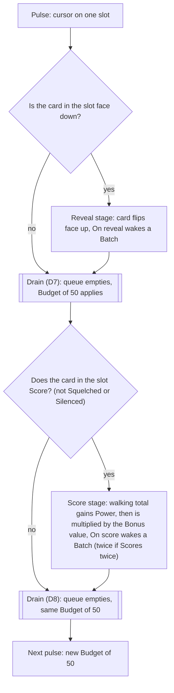
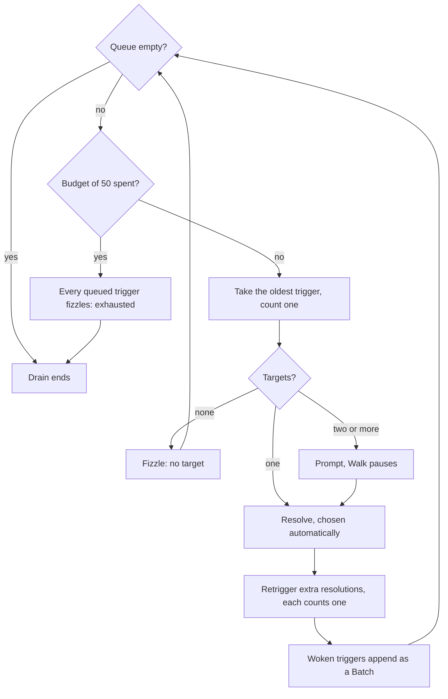

# Resolution chart (ruleset v2)

The rules in this note are built since DC-14 (rules version 7); the DC-13 and DC-14 rows of
[[planning/cycles]] record how and the readings made on the way. It says what happens next,
step by step, from turn start to turn end, and exactly when the trigger queue drains. The
game as built is described in [[systems/game-loop]]; the requirements are
R42 to R52 of [[specs/ruleset-v2/spec]]. Every word for a game concept is defined in
[[rules/glossary]]. The rules of the Match, Energy, Hand and statuses are in
[[rules/rules-v2]]; the Crew are in [[rules/crew-v2]]. Loop and retrigger examples come from
the card ideas in [[cards/Cards]].

## 1. The queue rules

Each rule has a label (Q1 to Q11) that the walkthrough and the traces cite. Each rule is
stated here and nowhere else; other notes link to it.

**Q1. One queue.** A resolving effect never resolves the triggers it wakes inline. The
triggers are appended to the one queue as a Batch, and the effect finishes first. The queue
then drains fully, oldest Batch first, before play moves to the next step. The Walk has one
queue; a step outside the Walk that wakes triggers (a draw, a Commit, a Discard, turn end)
uses the same rules with a fresh queue that drains at once.

**Q2. Batch and snapshot.** One resolution wakes one Batch. When the Batch is created, its
cards and Crew are fixed. An effect that later moves, Un-reveals or Condemns a card cannot
make it fire twice or skip it within that Batch. Whether a Muted or Silenced card may fire is
read when its trigger comes up, not at the snapshot. An On empty draw trigger does not
re-check that the Deck is still empty: every On empty draw trigger in the Batch fires, in
any Crew slot order (C29).

**Q3. Order.** Within one Batch, cards come before Crew. Among cards, the first seat's come
first, then the second seat's; each seat's cards go by slot, left to right. Among one seat's
Crew, Crew slot order. The exit pass at turn end uses the same seat order (rule Q10). This
is the only place the order is defined.

**Q4. Budget.** Each pulse has a Budget (trigger) of 50 trigger resolutions, counted across
both of its drains. A trigger taken off the queue counts one, whether it acts or fizzles for
"no target", and so does each extra resolution from a retrigger (Q6). When the 50 are spent,
every trigger still queued for that pulse fizzles with the reason "exhausted", visibly, and
the Walk continues with the next stage. The count starts again at 0 for the next pulse. This
is the only place the budget is defined.

**Q5. Amounts are read at resolution.** Every variable amount (a Power, a Cost, cards in a
Pile, the N in a text) is read at the moment the ability resolves, not when it was queued.

**Q6. Retriggers.** A retrigger ("trigger your other On reveals twice this turn") adds one
extra resolution of the same ability immediately after each resolution it applies to, before
the next trigger in the queue. Choices are made again and amounts are read again (Q5).
Retriggers stack by one extra resolution each, and never apply to themselves. Triggers woken
by the extra resolution form their own Batch at the end of the queue. "Twice" means two
resolutions in all, so one retrigger.

**Q7. Scores twice.** "Each card Scores twice this turn" runs the score stage of every pulse
that comes after it twice. Each run adds the card's Power to its Controller's walking total,
multiplies the total by the card's Bonus value, and wakes its On score Batch. A card that
Scores twice counts twice for any count of Scores (Tallyman). Both Batches are queued
before the score stage's drain. Unless the text says otherwise it covers cards on both rows.

**Q8. Crew.** Crew fire only after the effect that woke them has fully resolved: a Batch puts
its cards first and its Crew after them (Q3), and a Crew's own effect wakes a new Batch. Crew
are not cards: never on a row, never a target, never Condemned, moved or copied.

**Q9. Prompts.** An effect with no eligible target fizzles ("no target"). With one eligible
target it is chosen automatically. With two or more, play pauses on a Prompt for the
choosing seat, wherever the queue is draining (turn start, a Commit, the Walk or turn end),
and resumes at the same place in the queue. Crew Prompts are optional and may be skipped; a
Crew Prompt opens even for one eligible target, so Skip is always offered. An ability with an
optional count ("any number", "up to N": Immolator, Exhume) always Prompts, even with one
eligible target, and the choosing seat may choose none. The discard-down is a multi-select of
exactly the excess.

**Q10. Exits.** Condemned, Fleeting and Fade are exit marks. A card holds at most one and a
newer mark replaces an older one. They do nothing until the exit pass at turn end; a marked
card still Scores, and still fires its triggers, this Walk.

**Q11. Resumed draw.** When a seat's draw finds the Deck empty, its On empty draw Batch is
woken (Q1). Immediately after the last trigger of that Batch has resolved, if the Deck is no
longer empty the seat makes the draw it was denied, once; if the Deck is still empty,
nothing is drawn and no second On empty draw Batch wakes. This applies to any draw: the one
at turn start, and one made by an effect in the Walk or elsewhere. The resumed draw is a game
step, not a trigger: it still happens when the Batch ended because the Budget (trigger) of Q4
is spent, and it does not count against the Budget.

## 2. A Turn, step by step

Seats are called first and second for the seat that commits first and second this Turn (the
winner of the previous Turn, as [[rules/rules-v2]] sets out). "Drain" means the queue of Q1
empties, with prompts and the Budget (trigger) of Q4 applied. Drain points are marked **D1**
to **D12**.

**Turn start**

1. Fix the commit order. Both seats' Budget is set to the Turn number plus any granted Energy.
2. Each seat draws one card, first seat first. If its Deck is empty, nothing is drawn and the
   seat's On empty draw triggers wake as a Batch. **D1: drain.** Every On empty draw trigger
   in the Batch fires, whatever the Crew slot order, with no re-check that the Deck is still
   empty (C29). The seat then makes its draw again (the resumed draw of Q11, which applies to
   any draw, not only this one). If the Deck is still empty after the drain, nothing is drawn.
3. On start wakes one Batch of revealed cards and Crew. **D2: drain.**

**First commit**

4. The first seat Commits face down, paying Cost from its Budget. The Commit is accepted.
5. On commit wakes one Batch (this seat's revealed row cards, hand cards whose text says
   "while in your hand", and its Crew; never a card committed face down this Turn).
   **D3: drain.** A Prompt here belongs to whoever the effect names.
6. Discard-down. If the first seat's hand now holds more cards than its Hand size (read after
   D3), it chooses exactly the excess and Discards them to its Pile. Each Discard wakes On
   discard triggers as a Batch. **D4: drain.** Nothing else checks Hand size.

**Second commit**

7. The second seat Commits face down. Accepted.
8. On commit, as step 5 for the second seat. **D5: drain.**
9. Discard-down, as step 6 for the second seat. **D6: drain.**

**The Walk** (the cursor alternates between the rows from slot 0, first seat first)

10. For each pulse, in slot order, see the flowchart in section 3. Reveal stage, **D7:
    drain**, score stage, **D8: drain**. D7 and D8 are the only drains inside the Walk, and
    the Budget (trigger) belongs to each pulse. Cursor rules follow
    [[specs/cycle-5-walk-cursor/spec]]: a pulse belongs to its slot, a card moved ahead of the
    cursor is reached later this Walk, a card moved behind waits for the next Walk, and a card
    landing on the pulsed slot Scores now.

    *Reveal-stage hook.* A text that says "after its On reveal resolves and before it Scores"
    (Skip) acts once, right after D7 and before the score stage: its Move happens then, and
    the On moved Batch it wakes is queued and drains in D8, after the score stage. An
    Anchored card is not moved by the hook; a card that lands on the pulsed slot Scores now
    (the cursor rules above).

**Turn end**

11. At turn end, before the exit pass. One Batch wakes: the At turn end abilities of cards
    and Crew whose text says "before exit marks resolve" (Veil), in the order of Q3.
    **D9: drain.**
12. The exit pass. In the order of Q3 (the first seat's row first, slot order): Condemned
    goes to its Owner's Pile as a Discard, Fleeting goes to its Owner's hand, Fade Un-reveals
    in place keeping its Memory and losing its Board changes. At the start of the pass every
    Ongoing that changes exit marks (Wraith) is read once and kept for the whole pass, so a
    Wraith that is itself Condemned still applies to the other cards in this pass. When the
    pass is complete, each Discarded card wakes its On discard Batch, in pass order, snapshot
    taken after the pass so cards that left no longer watch. **D10: drain.** An exit mark
    given by this drain waits for the next turn end.
13. At turn end, after the exit pass. One Batch wakes: the At turn end abilities of cards
    and Crew whose text says "after exit marks resolve" (Shade), in the order of Q3, read
    against the rows as the exit pass left them. **D11: drain.** An exit mark given by this
    drain waits for the next turn end.
14. Turn-scoped statuses end: every status whose cessation is "until end of turn", and every
    status whose named condition is met.
15. Energy settles: unspent Energy is lost unless an ability says otherwise.
16. The Turn's winner is recorded (the higher Score; a tied Turn keeps the order). Each
    seat's Score is its walking total after its last Scoring card, rounded once to a whole
    number (half rounds up).

**After Turn 7** (Round end): every card on both rows goes to its Owner's Pile as a Discard,
hands and Decks stay as they are, and On discard wakes as a Batch. **D12: drain.** Then the
Round is awarded.

Twelve drain points in all: ten are outside the Walk, only D7 and D8 sit in a pulse.

## 3. One pulse

Inside a drain:

## 4. Statuses, exits and expiry

- A status given by an effect lasts until its stated cessation; with none stated it ends at
  turn end (step 14). A status tied to the board ends early if the card leaves its row or is
  Un-revealed; a "permanently" status is Memory and survives both.
- Mute stops a card's triggers (Q2 reads it when the trigger comes up); Squelch stops its
  Score at the score stage; Silence stops both. A card that is both Muted and Squelched is
  Silenced; ending one half leaves the other, and each half keeps its own end (see [[rules/glossary]],
  section 9). A "cannot be Muted" protection (Ward) turns a would-be Silence into a Squelch
  only.
- On squelch wakes when the card becomes Squelched alone. A card that becomes Silenced fires
  no triggers, so it has no On squelch; watchers of it may.
- Exits are step 12 only. Because a Condemned card still Scores and still fires, an
  opposing effect that Condemns it does not remove it from this Walk.

## 5. Traces of the nine scenarios

Each trace names the step or rule that decides it.

1. **On commit Squelch prompt.** Seat 0 commits first (step 4); the Commit is accepted, and
   step 5 wakes the On commit Batch with the revealed card. In D3 the card's effect finds
   two or more eligible targets, so Q9 pauses on a Prompt for seat 0, before step 6 and long
   before seat 1's Commit at step 7. The chosen card becomes Squelched until end of turn;
   seat 1 sees the Squelch badge when it commits. Step 14 ends the status. Decided by
   step 5, D3, Q9, step 14.
2. **Fleeting card Condemned.** An enemy effect gives Condemned to the Power 4 card; Q10
   says the newer mark replaces Fleeting, so it holds only Condemned. It Scores in the
   Walk (step 10, Q10) and fires normally. Step 12 sends it to its Owner's Pile as a
   Discard, and each watcher of On discard, on either row, fires in D10. Decided by Q10,
   step 12, D10.
3. **Muted, then Squelched.** The Squelch effect finds the card Muted; it becomes Silenced
   (section 4): the score stage skips it (flowchart node S) and its triggers do not fire
   (Q2). A later effect that ends the Mute leaves Squelched: it again fires its triggers
   but does not Score. Decided by section 4, Q2, flowchart node S.
4. **Retrigger and N.** The slot 0 card's On reveal resolves in D7 of its own pulse and
   sets the retrigger for this Turn. When the slot 2 card reveals later, its On reveal
   resolves; Q6 adds one extra resolution straight after, at the front of the queue. Each
   resolution asks a Prompt for a Discard from the hand (Q9) and reads N then (Q5): the
   first resolution uses the first Discard's Cost, the extra resolution uses the second
   Discard's Cost. Each Discard wakes On discard as its own Batch, queued behind. Decided
   by Q6, Q5, Q9.
5. **Two cards feeding each other.** Read as: each card reacts to the other's Score and its
   own. In the score stage of the pulse, the first Score wakes a Batch of both. Each
   resolution Condemns an enemy card and Scores again, and that Score wakes another Batch of
   both. Every taken trigger counts (Q4). The count reaches 50 inside one drain (D8); the
   triggers still queued fizzle as "exhausted" and the Walk moves to the next pulse with a
   count of 0. Condemned cards stay in their slots until step 12. Decided by Q4, D8.
6. **Empty Deck, Round 6 Turn 1.** Assumption: a Deck of 40 cards less the opening hand of
   four leaves 36 draws, one per Turn with no effect draws, so the Deck first runs dry at
   Round 6 Turn 2 (Turn 36 is Round 6 Turn 1). The scenario's Round 6 Turn 1 therefore
   assumes at least one earlier effect draw. At step 2 the seat would draw from an empty
   Deck, so On empty draw wakes a Batch. With Dredger, D1 shuffles the Pile into the Deck,
   and the resumed draw (Q11) succeeds. With Void alone, D1 records the grant for the seat's
   next Scoring card (Power +10, Add +0.5, Mult ×1.25, per [[rules/crew-v2]]) and the Deck
   is still empty, so nothing is drawn. With both, both trigger (C29): Dredger shuffles the
   Pile into the Deck, Void's grant applies, and the resumed draw (Q11) then succeeds, in
   either Crew slot order. Decided by step 2, D1, Q2, Q11.
7. **Hand of six.** At step 2 the seat drew to six. At step 7 it Commits one card, leaving
   five; step 8 drains On commit; step 9 compares five with Hand size four, so exactly one
   card must be chosen and Discarded, and its On discard drains in D6, all before the Walk
   (step 10). Decided by steps 7 to 9, D5, D6.
8. **Anchored shift.** A B C, B Anchored. "Your other cards each move one slot left" is one
   resolution. A at slot 0 moves left over the edge and wraps to slot 2 (the row is a ring
   for stepwise moves). C at slot 2 moves left into B's slot, slides past it, and lands in
   slot 0. B never moves. The row reads C B A. On moved wakes a Batch of A and C (not B), in
   Q3 order, after the effect has finished, never inline (Q1). Decided by Q1, Q3.
9. **The reviewer reads cards-v2.** No pulse is involved. This note's part is that every
   loop, retrigger, face-down leak or Controller change on a card is flagged in
   [[rules/cards-v2]] with a one-line pointer to the rule here that handles it (loops: Q4,
   retriggers: Q6, Scores twice: Q7, Crew timing: Q8); the vocabulary check is
   [[rules/glossary]]. Decided by Q4, Q6, Q7, Q8.

## 6. Where this note stops

Card and Crew texts live in [[rules/cards-v2]] and [[rules/crew-v2]]; Energy, Hand, Deck and
Pile rules live in [[rules/rules-v2]]. Nothing here adds a rule that the spec does not
imply. Where the spec was silent and this note chose a reading (the fresh queue outside the
Walk, the resumed draw of Q11, the snapshot after the exit pass, the reveal-stage hook, what
counts toward the Budget) the choice is open to Ben's veto at sign-off.
