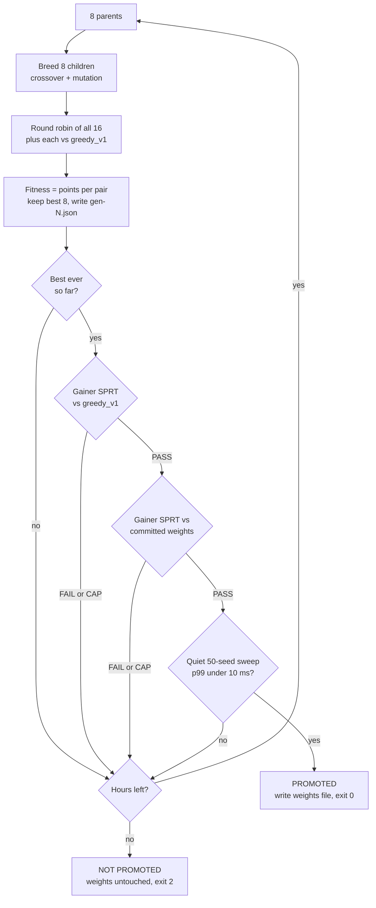

# Bots and training

> Who the computer opponents are, how we prove one is stronger than another, and how to run the overnight training that makes them stronger.

This guide is written from the code as it stands after cycle 11. The spec
([[specs/cycle-7-bot-players/spec]]) records why each piece exists. The ledger
([[planning/bot-ladder]]) records every measured bot. For how a match runs (commits, the
reveal, the score walk), see [[systems/game-loop]]. For the cards, Crew and decks the bots
play with, see [[systems/cards-crew-decks]].

One thing to know up front: both shipped weights files still hold the **untrained
defaults**. They have been re-stamped by hand after each rules change, but nobody has run
the training yet. So today the "tuned" bot plays almost exactly like the greedy bot. The
first overnight run is what changes that.

## The bots

Every bot is a pure function. It sees one seat's redacted view (never the opponent's
hand), asks the engine to *preview* its own hypothetical moves, and returns one action. It
reads no clock and keeps no state between calls. Every random draw comes from a fresh
generator seeded from the match seed, the round, the turn and a tag. The same view and seed
always give the same move, so every bot game replays exactly.

| Name | What it does | Levels | Role |
|---|---|---|---|
| `random` | Picks uniformly among the legal commits and prompt answers. | 20 only | The floor. |
| `greedy` | Lists every legal commit (each affordable set, in two or three card orders, at either end of the row), previews each one, and picks the best own-minus-opponent score. | 20 only | The pre-cycle-7 bot, still maintained. |
| `greedy_v1` | A frozen copy of `greedy` from cycle 6. Edited only when an engine API change forces it, and each edit is logged in the ledger. | 20 only | The yardstick everything is measured against. |
| `tuned` | The greedy search, pruned and scored by a weighted evaluator (below). | 0 to 20 | The shipped opponent, and the default. |
| `matrix` | Treats the blind commit as a small game against guessed opponent moves. | 0 to 20 | The experimental second rung. |

### The tuned bot

The greedy bot previews every candidate, which can be hundreds of previews. The tuned bot
first ranks the candidates by a cheap **bound**: what the committed cards alone would add
to its own row, from their printed stats, with no preview at all. It then previews only the
top `k` (24 today). Each previewed candidate gets a **value**: a weighted sum of 13 named
features, such as score difference, energy left, cards left, turns left, round wins, the
opponent's hand size and row-length difference. The highest value wins.

With the default weights (`score_diff` at 100, everything else 0), the value is exactly
the greedy score. That is deliberate: it makes the pruned bot testable against the full
search. Prompts (destroy this, recover that, the Crew's optional prompts) are answered the
same way: preview each option, value it, pick the best.

### The matrix bot

In this game the commit is sequential but blind: the first player commits face down, and the
second sees only how many cards went down and into which slots. So "my best move" depends on
what the opponent does or did. The matrix bot models that. It samples a few hands the opponent
*could* hold (from the opponent's public deck list, minus every card the view shows). From
those hands it builds the opponent's likely commits and keeps the top `k_opp`. Then it fills a
table: its own top `k` candidates down the side, the opponent's guesses across the top, and
in each cell the value of a **joint preview** of both commits together. Regret matching (a
simple iterative game solver, run for `rm_iterations` rounds) turns that table into a mixed
strategy. The bot then draws its move from it. If the opponent has already committed, only
guesses with the same card count and slots are kept.

The joint preview is built so the bot learns nothing hidden. A guessed card gives the
same result wherever the real card is (hand, deck or burn pile). Prompts are answered exactly
as the tuned bot does.

### Levels: the seeded push

Difficulty is a level from 0 to 20. Level 20 is full strength and changes nothing. Below 20,
the bot adds a seeded **push** to each candidate that sits within `push_unit` (10 points) of
the best: part of its gap to the best, plus a little noise. A weaker level closes more of the
gap, so near-best moves get picked more often. A move more than 10 points worse is never
lifted. So a low-level bot makes plausible second-best plays, never obvious blunders.
The level never removes candidates and never reveals anything. Only `tuned` and `matrix`
take a level. The launcher takes `--bot=<name>` and `--bot-level=<0..20>`.

### The 10 ms budget

The bot runs synchronously in the game, so a decision must be fast. The rule (R17) is that
the **99th-percentile decision** in the 50-seed sweep stays under 10 ms. The slowest single
decision is printed but not judged, since one OS hiccup decides it. `make sweep` measures it
for the tuned bot, and `make sweep BOT=matrix` for the matrix bot. Speed comes from fixed
whole-number caps (`k`, `k_opp`, `samples`, `rm_iterations`), never from a timer. A timer
would make play depend on the machine.

Measured so far: tuned p99 about 6.7 to 7.2 ms before Crew and 9.8 ms with Crew, close to the line. Matrix at 6/3/2/50 measured 8.8 to 9.3 ms
before Crew and 10.43 and 10.46 ms with Crew. The matrix bot is therefore **exempt from
R17** for now (cycle 8 C13, cycle 7 C17). That exemption is a decision, not code: the sweep
asserts p99 under 10 ms for whichever bot it runs.

### Weights files

Each bot with an evaluator has a committed file in `godot/engine/bot/data/`:

| Field | Meaning | tuned | matrix |
|---|---|---|---|
| `stamp` | The rules and data the file was measured under (see below) | `r6-c4cbd…` | `r6-c4cbd…` |
| `k` | Own candidates previewed | 24 | 6 |
| `k_opp` | Opponent guesses kept | (unused) | 3 |
| `samples` | Opponent hands sampled | (unused) | 2 |
| `rm_iterations` | Regret-matching rounds | (unused) | 50 |
| `push_unit` | The level push's reach, in points | 10 | 10 |
| `weights` | The 13 features, in hundredths (100 counts a feature once) | `score_diff` 100, rest 0 | same |

Everything is a whole number, so every machine plays alike. If a file is missing or
broken, the bot falls back to the defaults and the launcher prints one `Bot weights:`
warning.

## Measuring strength: `make bot-eval`

```bash
make bot-eval                       # tuned vs greedy_v1, non-regression
make bot-eval BOT=matrix            # matrix vs greedy_v1
make bot-eval BOT=matrix REF=tuned  # matrix vs the shipped tuned bot
scripts/bot-eval.sh --a matrix --b tuned --gainer   # the stricter "is it stronger" test
```

It prints one summary line and exits 0 (PASS), 1 (FAIL), 2 (CAP) or 3 (error). It is never
part of `make check`.

### Why paired seeds

Card games are noisy: one lucky shuffle can decide a game. So every seed is played as a
**pair**: the same shuffle twice, with the bots swapping seats. When the two decks differ,
the pair is played again with the decks swapped. Each bot then plays each deck from each
seat on the same cards. Luck of the draw and deck matchups cancel out, and what is left is
skill.

The two games of a pair are scored together, as 0, 0.5, 1, 1.5 or 2 points for bot A. That
five-way outcome is the **pentanomial** score. Scoring pairs, not games, matters because
the two games of a pair are correlated. Treating them as independent would overstate the
confidence.

### Why SPRT

A fixed number of games is either wasteful (when the difference is obvious) or too few
(when it is close). The **sequential probability ratio test** checks the evidence after
every pair and stops as soon as it is sure enough, with 5% error either way. It weighs two
hypotheses, in Elo-like units:

| Mode | Bounds | PASS means | FAIL means |
|---|---|---|---|
| non-regression (the default) | [−25, 0] | A is not worse than B | A is at least 25 Elo worse |
| gainer (`--gainer`) | [0, +25] | A is about 25 Elo stronger (scores roughly 53.6%) | A is no stronger |

If the seed range (default 1–5000) or the cap (20,000 pairs) runs out first, the result is
CAP: not enough evidence either way.

### How it runs

`scripts/bot-eval.sh` calls `scripts/bot/driver.py eval`. The driver splits the seeds into
batches of 25 and starts one headless Godot worker (`godot/tools/bot_worker.gd`) per CPU
core. Each worker plays its batch and writes JSON lines: one record per decision (with its
time in µs), per game, per pair, and an end record with counts. Every finished game's log
is **replayed** and its final state compared, so a determinism bug shows up as a replay
mismatch. The driver feeds pairs to the SPRT in seed order and stops at the deciding pair.
Reports land in `godot/reports/bot/<label>-<date>/` (gitignored), with `report.json` beside
the batches.

### The summary line

```
bot-eval: a=tuned b=greedy_v1 result=PASS bound=H1 pairs=48 games=96 winrate=0.510±0.036
first_committer=0.49 p95_us=15412 p99_us=21106 slowest_us=200041 overruns_a=641
overruns_b=755 stamp=match exit=0
```

| Field | Meaning |
|---|---|
| `result`, `bound` | PASS / FAIL / CAP, and which bound ended it (H1 = the PASS side, H0 = the FAIL side, `cap`) |
| `pairs`, `games` | How much was played before the test decided |
| `winrate` | A's mean pair score (0.5 = even) with a 95% interval |
| `first_committer` | How often the player who committed first won (a fairness check on the rules) |
| `p95_us`, `p99_us`, `slowest_us` | Decision times, p99 for A's own decisions |
| `overruns_a`, `overruns_b` | Decisions over 10 ms, per side. Counted, never failed |
| `stamp` | `match`, or `MISMATCH` when a weights file was stamped under other rules |
| `reason=` | Only in gainer mode: `rejected` or `replay` turns a PASS into a FAIL |

The timings in an eval are **not** the budget measure. The eval runs a worker on every
core, and that contention inflates them. The tuned bot shows a p99 of 17 to 21 ms here, but
about 7 ms in a quiet sweep.

## The stamp

The stamp says which game a weights file was tuned for:

```
r<RULES_VERSION>-<first 16 hex digits of SHA-256 over cards.json, decks.json, crew.json>
```

The rules version lives in `godot/engine/match_rules.gd` (6 today). The three data files are
in `godot/engine/data/`. The engine (`bot_stamp.gd`) and the scripts (`records.py`) compute
the same string. Today it is `r6-c4cbd3190e297787`.

Every sweep, eval, training run and calibration prints the stamp check. `MISMATCH` never
fails anything. It means "these weights were tuned for different rules or cards, so their
strength is unproven." That leads to the **rerun provision** (spec R36, `/cycle test` step
1b in `.claude/skills/cycle/SKILL.md`, and the checklist in [[planning/bot-ladder]]). When a
cycle changes the rules version or the data, then before the merge:

1. `make sweep` and `make sweep BOT=matrix`: read `stamp=` and `p99_us=`.
2. `make bot-eval` and `make bot-eval BOT=matrix`.
3. On FAIL or `stamp=MISMATCH`: `make bot-train` for each bot, and commit the promoted
   weights on the cycle branch.
4. Add a ledger row, and put the eval line in the cycle's row of [[planning/cycles]].

Until now step 3 was deferred to Ben's overnight run, so the files were re-stamped by hand
(plan P18).

## The training loop: `make bot-train`

```bash
make bot-train                          # tuned, 8 hours, default label
make bot-train BOT=matrix HOURS=6       # the matrix bot
make bot-train LABEL=tuned-night1       # name the run yourself
```

Training is **(μ+λ) evolution**, a plain genetic algorithm. It spends no model tokens: it
is Python and headless Godot only (`scripts/bot-train.sh` → `driver.py train` →
`scripts/bot/evolve.py`).

**The genome** is the weights file's 13 feature weights plus the bot's tunable caps. The
tuned bot tunes `k` within 1 to 24. The matrix bot tunes `k` within 1 to 6 and `k_opp` within
1 to 3. Those bounds (`TUNABLE` in `evolve.py`) exist because larger caps break the 10 ms
budget. `samples`, `rm_iterations` and `push_unit` are copied from the committed file and
never change. Weights are clamped to ±1000 hundredths.

**One generation:**

1. Eight parents breed eight children: each child takes each gene from one of two random
   parents, then gets Gaussian noise (σ 20 hundredths on weights, σ 2 on caps). The first
   generation's parents are the committed weights plus seven mutants of it.
2. All 16 play a **round robin** (every two individuals, 24 paired seeds) and each plays
   **`greedy_v1`** (48 paired seeds). That is 3,648 seeds per generation, on every core.
3. **Fitness** is each individual's pentanomial points per pair, scaled to 0–1. The best
   eight become the next parents.
4. A checkpoint `gen-N.json` is written.
5. If this generation's best beats the best fitness of every earlier generation, it is a
   **candidate** and goes to promotion. The first generation always yields one.

Every seed range comes from the **run seed**, printed on the first line and stored in each
checkpoint. A run can be replayed, and a resumed generation breeds the same children.

### Promotion

A candidate must pass three tests in a row (R41, as amended by C16):

1. **Gainer SPRT against `greedy_v1`** (up to 5,000 paired seeds). It must be clearly
   stronger than the yardstick.
2. **Gainer SPRT against the committed weights** (best-so-far, R23). It must be clearly
   stronger than what ships.
3. **A quiet 50-seed sweep** with the candidate's weights: one Godot process, nothing else
   running, exactly `make sweep BOT=<bot> WEIGHTS=<file>`. It must pass every invariant
   with a p99 decision **under 10 ms**.

Why the quiet sweep? Under the all-core eval, the shipped tuned bot itself measured p99
17.8 ms. A speed test inside the eval would reject everything. In a quiet sweep the same
bot measures about 7 ms. So speed is judged alone, once both strength tests have passed.

A rejected action or replay mismatch in an eval is a FAIL for that candidate, and the run
goes on. Any other worker failure stops the run with exit 3.

On promotion the trainer:

- rewrites `godot/engine/bot/data/<bot>_weights.json` with the new genome and the current
  stamp;
- copies the old file to `godot/reports/bot/<label>/previous_<bot>_weights.json`;
- marks the checkpoint `promoted`, prints a `PROMOTED` line, and **stops** with exit 0.

It never commits. A run stops at its first promotion; to keep evolving, start another run.



### Labels, checkpoints and resume

The default label is `<bot>-<stamp>`, for example `tuned-r6-c4cbd3190e297787`. Starting
again with the same label **resumes** from the newest checkpoint. A candidate whose
promotion was interrupted is re-tested first. Once a label has promoted, the next default run
gets `-2` (then `-3` and so on), so a finished run never swallows the next one. A label whose
checkpoint carries another stamp is **refused**: the rules changed, so pass a new `LABEL=`.
A label also refuses a different bot or a different run seed. Reusing an explicit label
that already promoted does nothing (it says "already promoted" and exits 0).

| Exit | Meaning |
|---|---|
| 0 | Promoted (or the label had already promoted) |
| 2 | Time limit reached, nothing promoted, weights untouched |
| 3 | Error: no Godot, bad flags, a refused label, a worker crash |

## Calibration: `make bot-calibrate`

Calibration answers "what does level 12 feel like?" in win rates. It plays the tuned bot at
each level against `greedy_v1` at full strength, on six deck pairings, 200 paired seeds per
cell. It prints a table and writes it into the `## Calibration` section of
[[planning/bot-ladder]], between the `calibration:begin` and `calibration:end` markers.
It then suggests tiers by win rate, not by level number: easy is the level nearest 0.35,
normal the level nearest 0.50, hard the strongest level.

```bash
make bot-calibrate                       # about 15 minutes on all cores
make bot-calibrate LEVELS=10,12,14 NO_LEDGER=1
```

The current table says level 12 wins about 0.35 against `greedy_v1` (easy). Level 20 wins
about 0.51 (normal). Since the untrained tuned bot is barely stronger than `greedy_v1`, there
is no distinct hard tier yet. Two details stand out. Bloom against Echo sits at 0.50 at every
level, which suggests the matchup decides that game whoever pilots it, and the deck swap
cancels it. Echo mirrors at level 20 reach 0.58, which fits the tuned bot reading reduced
costs while `greedy_v1` reads printed ones. Note that the table was measured under stamp `r5`,
before Crew. Rerun it after the first promotion.

## Running it yourself

### Before you start

- Run from a clean checkout on its own branch, cut from `master`. Promotion rewrites a
  tracked file, and nothing is committed on `master` directly.
- Close the Godot editor and anything heavy. Training uses every core.
- Keep the Mac awake. A sleeping Mac pauses the run. `caffeinate -i` in front of the
  command prevents idle sleep.
- Run it in a terminal tab, not piped through `tee`. The driver runs Python in isolated
  mode (`-I`), so its output is buffered when it is not a terminal, and progress lines
  would arrive late.

### The overnight run

Train the tuned bot first: it is the one players meet.

```bash
caffeinate -i make bot-train                 # tuned, 8 hours
```

Then the matrix bot, on another night or after the first run ends. Never run both at once:
they fight for cores, and the quiet sweep would no longer be quiet.

```bash
caffeinate -i make bot-train BOT=matrix
```

`HOURS=` sets the wall clock (default 8). At least one generation always runs. `LABEL=`
names the run. Other knobs need the script directly:

```bash
scripts/bot-train.sh --bot tuned --hours 8 --sigma 40 --label tuned-night2
```

`--sigma 40` doubles the mutation size, which is the plan's fallback if a first night
promotes nothing (`tasks.md` T16). `--k-max` and `--k-opp-max` lower the cap bounds.
`--run-seed` fixes the run seed.

### Watching progress

The terminal prints a line per generation:

```
bot-train: tuned label=tuned-r6-c4cbd3190e297787 run_seed=123456789 hours=8
bot-train: gen=1 best=3 fitness=0.5412 candidate=yes
bot-train: gen=2 best=11 fitness=0.5288 candidate=no
```

`best=` is the individual's index. Its weights are in `gen-N-files/ind-<index>.json`. A
`candidate=yes` line is followed by two evals and possibly a sweep, which can take a while.
Fitness is relative to that generation's field, so it can drift down even as the bots get
better. Only a promotion proves progress.

Everything lives in `godot/reports/bot/<label>/`: the `gen-N.json` checkpoints, the
`gen-N-files/` weights, one folder per promotion eval (`gen<N>-vs-greedy_v1-<date>/`,
`gen<N>-vs-best-<date>/`) and, after a promotion, `previous_<bot>_weights.json`. From another
tab:

```bash
python3 - godot/reports/bot/tuned-r6-c4cbd3190e297787 <<'EOF'
import glob, json, os, sys
paths = glob.glob(os.path.join(sys.argv[1], "gen-*.json"))
for p in sorted(paths, key=lambda p: int(p.rsplit("-", 1)[1][:-5])):
    c = json.load(open(p))
    print("gen %3d  best %.4f  promoted %s  pending %s  %d min"
          % (c["generation"], c["best"]["fitness"], c["promoted"], bool(c["pending"]),
             c["elapsed_s"] // 60))
EOF
```

### Stopping and resuming

Press Ctrl-C. That stops the driver and its Godot workers. Finished generations are kept,
and the generation in flight is lost. To resume, run the same command again (same `BOT=`,
and the same `LABEL=` if you set one). `HOURS=` counts from the restart.

### Reading the result

A promotion ends with one line, ready for the ledger:

```
bot-train: PROMOTED gen=7 stamp=r6-c4cbd3190e297787 vs_greedy_v1=PASS(PASS pairs=… winrate=…)
vs_best=PASS(PASS pairs=… winrate=…) quiet_sweep=PASS(p99_us=7310)
```

The weights file has been rewritten. Check `git diff godot/engine/bot/data/`, then hand over
to the orchestrator (or do it yourself):

- Commit the weights file, for example `dc-NN: T16 trained weights r6-c4cbd3190e297787`.
- Run `make check`. A promoted tuned bot plays differently, so the seed-1 golden pins will
  probably need re-pinning.
- Run `make sweep` for the bot you trained.
- Add a ledger row with the `PROMOTED` line, then rerun `make bot-calibrate`.

Without a promotion, the last line looks like this (and `make` adds `Error 2`, which is
expected, not a crash):

```
bot-train: NOT PROMOTED label=tuned-r6-… generations=41 (this run 41) best_fitness=0.55
last_candidate=gen12 vs_greedy_v1=FAIL(exit 1)(FAIL pairs=… winrate=…) stamp=r6-… exit=2
```

Nothing changed in the repository. Record the best candidate's result in the ledger, and
consider a second night with a wider `--sigma`.

### The matrix caveat

The quiet sweep has no exemption: it requires p99 under 10 ms for every bot. With Crew, the
matrix bot at its shipped caps (6/3/2/50) measured 10.4 ms. So a matrix candidate at those
caps will most likely fail with `quiet_sweep=FAIL … reason=p99`. One that evolved a smaller
`k` or `k_opp` might pass. Settling this (lower caps, or a different rule) is the open
decision from cycle 7 C17. Also note that the trainer's second test pits a matrix candidate
against the committed **matrix** weights. The spec's milestone check (R54) also wants it to
beat the **tuned** bot: run
`scripts/bot-eval.sh --a matrix --b tuned --gainer` after a promotion.

## Troubleshooting

| Symptom | Cause and fix |
|---|---|
| `worker seeds … exit 3` mid-run | The checkout changed under the run. A merge into the worktree during a DC-10 training smoke did exactly this. Never merge, switch branches, pull or edit `godot/` while a run uses that checkout. Restore it, then resume. |
| `Godot not found at …` | Set `GODOT_BIN=/path/to/Godot`. |
| `label … holds a checkpoint stamped … current stamp is …` | The rules or data changed since that run. Start fresh with a new `LABEL=`. |
| `stamp=MISMATCH` on any line | The weights were tuned for other rules. Not an error: it is the signal to retrain. |
| `quiet sweep FAIL reason=p99` | Too slow, or the machine was busy at that moment. Keep the Mac idle; for the matrix bot, see the caveat above. |
| `REJECTED (… worker exit 1)` | A candidate made an illegal move or a game failed to replay. The run carries on, but this points at a bug worth reporting. |
| Eval timings far above 10 ms | CPU contention from the all-core eval. Expected; judge speed by `make sweep`. |
| No output for a long time | Output is buffered when piped. Watch the checkpoints instead. |

## Where to look in the code

| File | Responsibility |
|---|---|
| `godot/engine/bot/bot_player.gd` | Base class: `choose()`, the per-decision seed |
| `godot/engine/bot/bot_registry.gd` | Every bot by name, levels, default weights, `default_name()` = `tuned` |
| `godot/engine/bot/greedy_bot.gd`, `reference/greedy_v1_bot.gd`, `random_bot.gd` | The reference bots |
| `godot/engine/bot/candidate_gen.gd` | All candidate commits, the cheap bound and ranking |
| `godot/engine/bot/evaluator.gd` | The 13 features, the weighted value, the level push |
| `godot/engine/bot/tuned_bot.gd` | The shipped bot: top-`k` previews, prompts, Crew prompts |
| `godot/engine/bot/matrix_bot.gd`, `hand_sampler.gd`, `regret_matching.gd` | The matrix bot, opponent hand sampling, the solver |
| `godot/engine/bot/bot_weights.gd`, `bot_stamp.gd`, `data/*_weights.json` | Weights files and the stamp |
| `godot/tools/bot_worker.gd`, `bot_worker_records.gd` | Headless worker: plays seed pairs, times, replays, writes JSONL |
| `godot/tests/sweep/test_sweep.gd` | The 50-seed sweep and its p99 assertion |
| `scripts/bot/driver.py` | `eval`, `train`, `calibrate`, `selftest`; worker fan-out and the summary line |
| `scripts/bot/sprt.py`, `records.py` | The pentanomial SPRT; aggregates and the Python stamp |
| `scripts/bot/evolve.py` | The trainer: genome, generations, checkpoints, promotion |
| `scripts/bot/calibrate.py` | The level grid and the ledger table |
| `scripts/bot-eval.sh`, `scripts/bot-train.sh`, `Makefile` | Entry points (`bot-eval`, `bot-train`, `bot-calibrate`, `bot-selftest`, `sweep`) |

`make bot-selftest` runs the Python unit tests for the driver, SPRT, trainer and
calibration.

## Related

- [[systems/systems-moc]]
- [[systems/game-loop]]: the match the bots play
- [[systems/cards-crew-decks]]: the cards, Crew and decks the stamp hashes
- [[planning/bot-ladder]]: every measured bot, the calibration table, the rerun checklist
- [[planning/cycles]]: the cycle log rows for DC-08, DC-10 and DC-11
- [[specs/cycle-7-bot-players/spec]], [[specs/cycle-7-bot-players/plan]], [[specs/cycle-7-bot-players/tasks]]
- [[specs/cycle-8-ramp-bounce-crew/spec]]: Crew, the three-file stamp (R58) and C13
