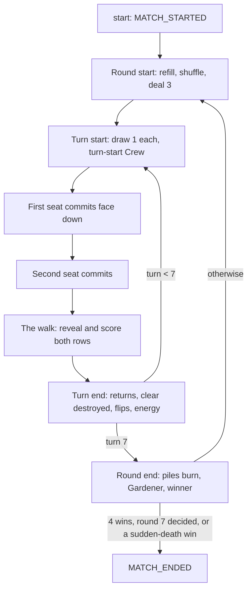
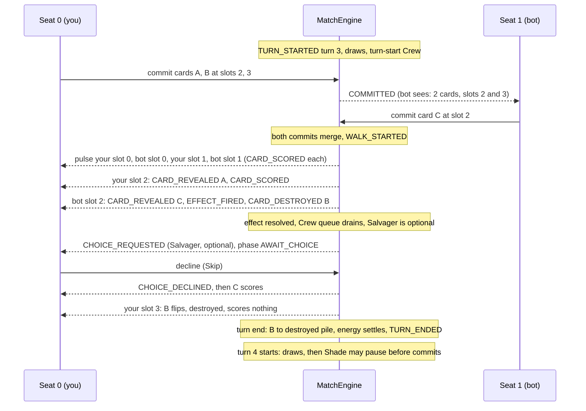

# Game loop, events and triggers

> How a Midnight Earth match runs today, from the first deal to the last round: the turn, the walk, the actions a seat can take, the events the engine reports, and when card effects and Crew fire.

Written from the code in `godot/engine/` as of DC-11 (rules version 6). Where a spec differs, the code wins and the difference is called out. Cards and Crew themselves are in [[systems/cards-crew-decks]]; bots are in [[systems/bot-training]].

## The shape of a match

A match is two seats, 0 and 1. Each seat plays a 20-card deck and has three Crew. The board always seats the human at seat 0.

| Unit | Rule (from `MatchRules`) |
|---|---|
| Match | First to **4** round wins. After round 7, more round wins takes it. If wins are level, **sudden death** rounds follow until one is won. |
| Round | **7** turns. Both decks refill and reshuffle and both rows clear. Each seat is dealt **3** cards. |
| Turn | Each seat draws 1 card, then both commit, then the walk scores both rows. |
| Hand | At most **7** cards. A card drawn at the cap is burned. |

The rows persist for the whole round: a card played on turn 2 is still there on turn 7, and every walk scores the whole row again from zero. That is the heart of the game.

A round is won by the higher score on turn 7's walk. Earlier turns add nothing to a total; their winners only decide **who commits first** next turn. A tied round awards no win. Concede ends the match at once, at any moment, even mid-prompt.

## A turn, step by step

### Who commits first

Turn 1 of round 1 goes to a coin flip. After that, the seat that **won the most recent round goes second** on turn 1, so the loser leads. Tied rounds are skipped when looking back. Within a round, the **winner of the last turn commits first**. A tied turn keeps the same order. The code is in `MatchEngine._round_first_seat()` and `_begin_turn()`.

Going first is a real cost. The first seat commits blind. The second seat knows how many cards the first seat placed and which slots they went into, but not which cards.

### Energy, budget and free-first

A turn's base energy equals the turn number, so turn 1 has 1 and turn 7 has 7. A seat's **budget** is that base plus any energy a carry card saved from last turn (`budget_for(seat)`). Unspent energy is lost unless a revealed carry card is on the row at turn end.

**Free-first** is a one-shot grant from an effect: the seat's next commit doesn't pay for its leftmost card. That commit uses the grant up even if it holds no cards. Carry, free-first and the "next card has no bonus" mark all reset at round start, so a last-turn effect never reaches into the next round.

Costs are **effective** costs: a card's memory can lower its printed cost, down to 0. `LegalPlays.validate_with` checks budget, that each card is in the hand once, and that the slots are valid.

### The commit: blind, not simultaneous

The commit is sequential but blind ([[planning/phase-3-game-loop]] R1, amended by R8). The first seat's cards wait face down in `pending` while the phase moves from `AWAIT_FIRST` to `AWAIT_SECOND`. Then the second seat commits.

A commit names cards and **final slots**: slot 2 means "this card ends up at index 2". Old cards keep their order and slide around the new ones. No slots means append at the right; no cards is a pass. When the second commit lands, `_resolve()` merges both into their rows, first seat first, and starts the walk.

### The walk

The walk is the scoring pass (`ScoreWalk`). It is also the moment the board animates the cursor stepping along the rows.

- **Reset.** Both scores go to 0 and both running multipliers go to ×1.00.
- **Alternate.** The cursor pulses the first seat's slot 0, then the second seat's slot 0, then the first seat's slot 1, and so on. When one row runs out, the other finishes alone. Each slot is pulsed exactly once.
- **Reveal, then score.** If the pulsed card is face down, it flips first. This is `CARD_REVEALED`, and its on-reveal triggers fire (see below). Then the card in that slot scores (`CARD_SCORED`).
- **Score maths.** Each seat carries a running multiplier through its row. A card's ×-part multiplies it and its +-part adds whole units to it. Then the card adds `flat × multiplier`, rounded down. All of this is integer hundredths, so every platform agrees.

The running multiplier is why **order on the row matters**: a ×1.5 card in slot 0 boosts everything to its right, every walk, all round. Moves, flips and destroys exist to play with that order.

A pulse belongs to its *slot*: if an effect moves another card into it mid-pulse, that card scores. A card moved ahead of the cursor is reached later; one moved behind it waits for the next walk. A **destroyed** card stays in its slot until turn end; the cursor flips it if face down and it scores nothing. The full rules are in [[specs/cycle-5-walk-cursor/spec]].

### Turn end, round end

When the walk finishes, `_end_turn()` runs these steps in a fixed order:

1. Return marks resolve. Marked cards go back to their owner's hand, or burn at the cap.
2. Destroyed cards leave their rows for their seat's destroyed pile.
3. Echo cards flip face down in place, ready to reveal again next walk.
4. The Crew queue drains (see Triggers).
5. Energy settles. A revealed carry card saves `budget − spent` for next turn.
6. `TURN_ENDED` reports the walk scores and the turn's winner.

After turn 7, `_end_round()` burns both destroyed piles, fires round-end Crew (Gardener), then awards the round and emits `ROUND_ENDED`. Gardener's growth lands after the scores are final, so it only matters in later rounds.

## Actions: the only way in

Everything a seat does is one `EngineAction`, accepted only from the seat `awaited_seat()` names. A rejected action changes nothing (no state, events or log entry) and returns an `EngineError` code.

| Action | Log form | When it is legal |
|---|---|---|
| `commit` | `{"k":"commit","s":0,"c":[3,7],"p":[0,2]}` | Phase `AWAIT_FIRST` from the first seat, or `AWAIT_SECOND` from the other seat. It must be within budget. It is never legal while a prompt is open. |
| `choose` | `{"k":"choose","s":1,"z":1,"i":0}` | A single-target prompt is open for this seat, and zone + index is one of its options. |
| `choose_set` | `{"k":"choose_set","s":0,"z":1,"i":[0,2]}` | A **multi-select** prompt is open, such as the sacrifice. The set may be empty, which declines that prompt. |
| `decline` | `{"k":"decline","s":0}` | An **optional** prompt is open for this seat. In the UI this is the **Skip** button. |
| `concede` | `{"k":"concede","s":1}` | Always, from either seat. |

Each accepted call runs the match to the **next decision point** and returns every event on the way. So the second commit returns a whole batch: the walk, the turn end, the next turn's start and draws, maybe a round end.

### Prompts

A prompt opens when an effect has two or more eligible targets. One target is chosen automatically (`CHOICE_MADE` with `auto` true); none, and the effect fizzles. The phase becomes `AWAIT_CHOICE` and the walk stops where it was. Options are **positions** in a zone (own hand, opponent board…), never card ids, so a face-down card can be picked without being named.

Every prompt carries two flags:

- **`optional`.** Today only **Crew** prompts are optional, and they open even for a single target so that Skip is always offered. Every card prompt has `optional: false`, so declining one fails with `NOT_OPTIONAL`.
- **`resume`.** This says what to continue once the prompt is answered. `"walk"` resumes the paused pulse at the exact stage it stopped, such as the next watcher or the score. `"turn_start"` resumes the turn-start Crew sequence (`TurnStart`). That sequence can pause the turn **before anyone commits**: Shade on turn 4 asks its seat first, and commits are rejected until it answers.

## Events: what happened, and who may know

A `MatchEvent` has a `kind`, a `payload` and an `owner_seat`. Public events have owner `-1`. Private events belong to one seat. `ApplyResult.events_for(seat)` gives each seat its own copy through `MatchEvent.redacted_for(seat)`:

- The owner sees a private event unchanged.
- For the other seat, every card id under `card` or `cards` becomes `-1`. The seat, slot and count stay visible.
- A private `CHOICE_MADE` hides only the `target`.
- A private `STATS_CHANGED` also shows neutral stats: flat 0, ×1.00, +0, cost 0.

Why so strict? An instance id maps to a definition through the public deck lists. Revealing an id is the same as revealing the card. A hidden card's stats would name it too.

| Event | When it fires | Who sees the card |
|---|---|---|
| `MATCH_STARTED` | First event of `start()`. It carries both deck ids and Crew, and never the seed. | Public |
| `ROUND_STARTED` | Each round, with the first seat and whether a coin decided it | Public |
| `CARD_DEALT`, `CARD_DRAWN` | Opening hand; turn-start and effect draws | Owner only |
| `CARD_BURNED` | A draw at the hand cap. Also a return or salvage at the cap, which burns from the row, and a recovery from a pile at the cap. | Owner. A revealed card burned from a row is public. |
| `TURN_STARTED` | Each turn, with energy, both budgets, free-first and the first seat | Public |
| `COMMITTED` | Each commit | Count and slots are public; the cards are owner only |
| `WALK_STARTED` | After both commits merge | Public |
| `CARD_REVEALED` | The cursor flips a face-down card | Public |
| `CARD_SCORED` | A card scores. It carries the multiplier, the points added, the running score and `again`. | Public |
| `EFFECT_FIRED`, `EFFECT_FIZZLED` | A card effect fires, or finds no target or has no uses left | Public |
| `CHOICE_REQUESTED`, `CHOICE_MADE`, `CHOICE_DECLINED` | A prompt opens, is answered, or is skipped | Requested and declined are public. Made hides its target when it is in a hand or face down. |
| `STATS_CHANGED` | Flat, bonus or cost changed: growth, flat-up, no-bonus mark, end-of-walk clear | Public on a revealed card; owner only in a hand or face down |
| `CARD_DESTROYED` | A destroy marks a card in place | Public if revealed. Otherwise only the owner sees which card. |
| `CARD_MOVED`, `CARD_UNREVEALED` | Drift moves; un-reveals from Echo, Phoenix, Shade or Veil | Public, except a face-down card's move and Veil un-destroying a face-down card (owner only; the other seat sees the slot) |
| `CARD_RETURNED`, `CARD_DISCARDED`, `CARD_RECOVERED`, `DESTROYED_CLEARED` | Turn-end returns and clears; discards; recovering from a pile | Public when the card's identity already was; discards are owner only |
| `BONUS_ZERO_SET`, `FREE_FIRST_SET`, `ENERGY_CARRIED` | The three "next turn" effects | Public |
| `CREW_FIRED` | A Crew ability fires, with uses left | Public |
| `TURN_ENDED`, `ROUND_ENDED`, `CONCEDED`, `MATCH_ENDED` | The ends | Public |

### From events to animation

The board animates **seat 0's redacted events**, never the engine's state. `MatchDriver` keeps `events_for(0)` of each call; `BoardSteps.from_events()` turns them into timed `BoardStep` beats (0.12 s for a plain pulse up to 0.6 s for the turn-end tally, ÷4 under autoplay); the board plays them one at a time, with `EffectPlayer` doing the lifts, flips, moves and destroys. A few mappings shape the feel:

- A `CARD_REVEALED` and its own `CARD_SCORED` fold into one **PULSE**: the card flips, then its score chips follow.
- A run of `CARD_MOVED` events is one re-layout.
- The opponent's `COMMITTED` becomes a "bot thinks" wait, then face-down cards slide in.
- Only the viewer's own `CHOICE_REQUESTED` becomes a beat; the bot's pick glows on `CHOICE_MADE`.
- The three "next turn" events have no beat; the next `TURN_STARTED` shows their result.

## Triggers: when effects fire

Each card carries at most one `CardEffect`: a trigger, a verb, an amount and optional limited uses. The walk decides when the trigger fires. Inside one pulse, the order is:

1. **Reveal.** `CARD_REVEALED`. If the revealing seat carries the "next card has no bonus" mark, it is spent on this card.
2. **`on_reveal`.** The card's own effect.
3. **`on_opponent_reveal` watchers.** These are the other seat's revealed, live cards, in row order.
4. **`on_ally_reveal` watchers.** These are the revealing seat's *other* revealed, live cards, in row order.
5. **Score.** `CARD_SCORED`.
6. **`on_opponent_score` watchers.** The other seat's cards, for example the burst.
7. **`on_score`.** The card's own effect, if it is still face up and live. It fires every time the card scores.

Watcher lists are **snapshotted** when their stage starts. A watcher that moves another card can't make it fire twice or skip it. `ongoing` effects never "fire" in a pulse. They are read whenever stats are computed, like the neighbour and edge ×-parts. The carry card and the Echo flip act at turn end. `on_moved` fires inside the move that caused it. A destroyed card fires nothing, by any trigger.

### The Crew trigger queue

Crew don't react inline. When an effect destroys, moves, returns or un-reveals a card, it **pushes** an entry onto `MatchState.crew_queue`. Each entry records the trigger, the card's controller and the card. A push happens only when that seat has a Crew listening for the trigger. The queue is **drained** only after the causing effect has fully resolved. That is the rule from [[specs/cycle-8-ramp-bounce-crew/spec]] R46: a Crew never fires *inside* an effect. "Destroy two cards" settles its count before Salvager or Veil gets a say.

These are the drain points:

| Where | When |
|---|---|
| The walk | After each on-reveal effect, after each watcher, after a score's bursts and on-score effect together, and before any resumed step. A Crew prompt here pauses the pulse like a card prompt does. |
| Turn start | After each turn-start Crew (Quartermaster's draws, Shade's flip). Lookout reacting to Shade's flip happens here. |
| Turn end | After the returns, the clear and the Echo flip, before energy settles |
| Round end | After the round-end Crew fire |

Within one drain, each seat's entries fire in **row order** of their cards (R45). Each entry offers the seat's Crew in slot order. A Crew with no eligible target or no uses left does nothing and counts nothing (R48). Outside the walk, an optional Crew is declined automatically. In practice none can come up there, because only a destroy opens a Crew prompt.

## Determinism, replay and hidden information

The engine is a pure function of **seed + deck ids + actions**. Its main random stream, `MatchRng`, is seeded from the match seed (a seeded deck pairing draws from its own derived stream); nothing reads the clock or the global generator. The stream is used for the round-start shuffles (seat 0's, then seat 1's), the turn-1 coin flip until a round is won, and a random destroy at the moment it fires. Walk order is fixed, so the same actions always draw the same numbers.

The **action log** (`ActionLog`) is a header plus the accepted actions:

`{"format": 4, "rules": 6, "seed": "…", "decks": ["ruin","drift"], "actions": [ … ]}`

The seed is a string because JSON loses precision above 2^53. `replay()` rebuilds the match and applies every action in order. Another format fails with `FORMAT_MISMATCH`, another rules version with `RULES_MISMATCH` (format 4 added `decline`; rules 6 added the Crew), so an old log is never reinterpreted under new rules.

**Why `to_dict()` and `duplicate()` must cover every field.** All of a match's progress lives in `MatchState`, including the paused walk (`walk.paused_*`), the turn-start cursor, the open prompt, Crew uses and the Crew queue. Three things depend on that:

- **Replay tests** compare `full_state()` (`to_dict()`). A field it leaves out is one replay can silently get wrong.
- **Previews** finish a walk on a `duplicate()`. A field the copy shares or drops lets a preview corrupt the live match or resume a pause in the wrong place.
- **Pausing** works only because the pause is data: a prompt can sit open across calls only if every piece of "where we were" is in the state.

So a new `MatchState` field goes into the class comment, `to_dict()`, `duplicate()` and a test, in the same change.

**What each seat can see.** `view_for(seat)` builds a `SeatView`: its own hand (with effective costs and stats), both rows with each card's shown stats and revealed and destroyed flags, the opponent's hand and deck *counts*, the count and slots of a face-down commit, budgets, scores, wins, Crew uses and the open prompt. It never holds the seed, the stream state, any deck order, or the id of an opponent card in a hand, deck, face-down commit or burn pile. Bots read only their own view, and their previews blank the opponent's unrevealed cards before scoring ([[systems/bot-training]]).

## Life of a turn

Here is an illustrative turn 3. You (seat 0) won turn 2, so you commit first. Each row already holds two cards from turns 1 and 2. You place a 1-cost card at slot 2 and a 2-cost card at slot 3, for a budget of 3. The bot plays one card at slot 2, and that card destroys a random opponent card on reveal. You have Salvager.

Notice: the bot learned only "two cards, slots 2 and 3" from your commit. B was destroyed face down, so the bot's copy of `CARD_DESTROYED` shows the slot, not the card. Salvager asked only once the destroy had resolved, and your Skip is logged as `decline`, so replay closes the same prompt in the same place. And the bot's commit call returned everything through turn 4's start in one batch.

## Where to look in the code

| File | Responsibility |
|---|---|
| `godot/engine/match_engine.gd` | Entry point: `create`, `start`, `apply`, `awaited_seat`, `view_for`, previews; rounds, turns, commits, turn and round end |
| `godot/engine/match_state.gd` | All mutable state; `to_dict()` and `duplicate()` |
| `godot/engine/match_rules.gd` | Constants: rounds, turns, hand cap, rules version, log format |
| `godot/engine/score_walk.gd` | The cursor, pulse stages, scoring maths, effective stats and costs, trigger hooks |
| `godot/engine/effect_resolver.gd` | Applying one card effect, prompts and answers, turn-end returns, clears and energy |
| `godot/engine/crew_effects.gd` | The eight Crew and the trigger queue |
| `godot/engine/turn_start.gd` | Turn-start Crew and the pause before commits |
| `godot/engine/legal_plays.gd` | Budget, slot and legality checks; legal subsets for bots |
| `godot/engine/choice.gd` | Prompt zones, eligibility, optional and resume flags |
| `godot/engine/engine_action.gd`, `match_event.gd` | Actions and events, their dictionary forms, redaction |
| `godot/engine/seat_view.gd` | One seat's redacted view |
| `godot/engine/action_log.gd`, `match_rng.gd` | The log, replay, the seeded stream |
| `godot/board/match_driver.gd` | Owns the engine and bots for the board; keeps seat 0's events |
| `godot/board/board_steps.gd`, `board_step.gd` | Events to animation beats, with timings |
| `godot/board/effect_player.gd` | Plays pulses and effect motions on the table |

## Related

- [[systems/systems-moc]]: the other system guides
- [[systems/cards-crew-decks]]: cards, effects, the eight Crew, deck lists
- [[systems/bot-training]]: bots, previews, training
- [[planning/phase-3-game-loop]]: the original rules decisions (R1–R9)
- [[specs/cycle-1-match-engine/spec]]: the engine, log and replay contract
- [[specs/cycle-4-card-effects/spec]]: effects, prompts, previews
- [[specs/cycle-5-walk-cursor/spec]]: the cursor and destroyed cards
- [[specs/cycle-6-constructed-decks/spec]]: decks, ×/+ scoring, piles
- [[specs/cycle-8-ramp-bounce-crew/spec]]: memory, Echo, Crew, optional prompts (R45–R55)
