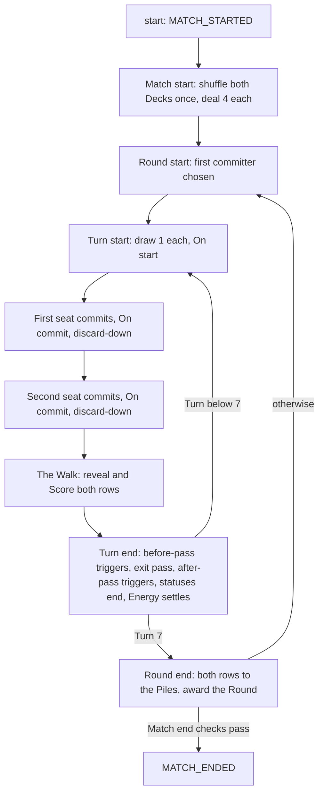
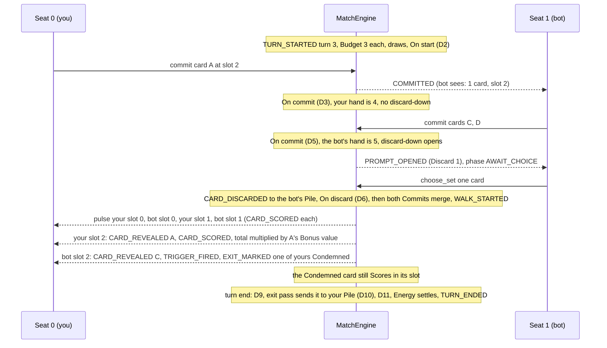

# Game loop, events and triggers

> How a Midnight Earth match runs today, from the first deal to the last Round: the Turn, the Walk and its walking total, statuses, movement, the trigger queue, the actions a seat can take, the events the engine reports and what each seat may know.

Written from the code in `godot/engine/` as of DC-20 (rules version 10, log format 5). The design canon is in [[rules/rules-moc]]; this guide is its as-built counterpart, and where the build reads the canon differently the difference is called out in [[#Where the build differs from the canon]]. Where a spec and the code differ, the code wins. Cards, Crew and decks are in [[systems/cards-crew-decks]]; the one bot is in [[systems/bot-training]]. How the rules were built is in the DC-13 and DC-14 rows of [[planning/cycles]]. Every capitalised word is defined in [[rules/glossary]].

## The shape of a match

A Match is two seats, 0 and 1. Each seat plays a 40-card Deck and brings three Crew. The board seats the human at seat 0. The numbers live in `MatchRules`.

| Unit | Rule |
|---|---|
| Match | First seat to **4** Round wins. After Round 7 the seat with more Round wins takes it. While the seats are level, **sudden-death** Rounds follow until one is won. A tied sudden-death Round ends the Match on a **stalemate** (below) when no card was committed all Round, when both Decks and both hands are empty with no refill, or when it is the third in a row to tie, so a Match is over after Round 10 at the latest. |
| Round | **7** Turns. A Round goes to the seat that won **more of its Turns**; equal Turn wins award no Round win. Nothing is dealt, refilled or reshuffled at Round start. At Round end both rows go to the Piles. |
| Turn | Each seat draws 1 card, then On start triggers fire, then both seats Commit (each followed by its discard-down), then the Walk scores both rows, then turn end. |
| Energy | **Energy equals the Turn number**: 1 on Turn 1, 7 on Turn 7, plus any Energy an ability grants that Turn. Unspent Energy is lost. |
| Hand | The opening hand of **4** is dealt once, at Match start. The base Hand size is **4**; a hand may be larger during a Turn and is cut down by the discard-down after its seat's Commit. |
| Deck and Pile | A Deck is **40** cards, at most 4 copies of a card, shuffled once at Match start. Each seat has one face-up public **Pile** for the whole Match. |

The rows clear at every Round end, so a card played on Turn 2 is on its row through Turn 7 and every Walk scores the whole row again from zero. The Walk's walking total makes **order on the row** the heart of the game.

A Round is **not** decided by Turn 7 alone: each Turn's higher Score is one Turn win (a tied Turn is no win), and the Round goes to the seat with more Turn wins (spec C13). Concede ends the Match at once, at any moment, even mid-prompt.

## A Turn, step by step

The module for everything outside the Walk is `turn_flow.gd` (`TurnFlow`). `MatchEngine` validates actions and sequences its calls. The step numbers below are those of [[rules/resolution]] section 2, and **D1 to D12** are its drain points (see [[#The trigger queue]]).

### Who commits first

Turn 1 of Round 1 goes to a seeded **coin flip**. On Turn 1 of every later Round, the seat that **lost the previous Round** commits first. After a tied Round there is no loser, so the alternation simply continues: the seat that did not commit first on the last Turn of that Round goes first (spec C25). Inside a Round, the **winner of the last Turn commits first**; a tied Turn keeps the order. The code is `TurnFlow.begin_round()` and `begin_turn()`.

Going first is a real cost. The first seat commits blind. The second seat knows how many cards the first seat placed and which slots they went into, but not which cards.

### Turn start (steps 1 to 3)

`TURN_STARTED` reports the Round, the Turn, the first seat and both Budgets. Each seat then draws one card, the first seat first (`TurnFlow.draw()`).

- **Empty Deck.** A draw from an empty Deck draws nothing and fires `DRAW_EMPTY`. The seat's On empty draw Batch then drains (D1): every such trigger fires, in any Crew slot order, **with no re-check that the Deck is still empty** (spec C29). Then the **resumed draw** (Q11) happens once: if the Deck is no longer empty, the denied card is drawn; if it still is, nothing is drawn and no second On empty draw wakes. This holds for any draw, including a draw made by an effect. The resumed draw is a game step, not a trigger: it still happens when the Batch ended because the Budget (trigger) is spent, and it does not count against the Budget.
- Then the On start Batch of revealed cards and Crew drains (D2). Quorum, Hex and Dynamo act here, and a prompt here pauses the Turn before anyone Commits.

### Energy, Budget and Cost

A seat's **Budget** on Turn N is N plus the Energy granted for this Turn (`TurnFlow.budget()`): Dynamo's "+1 Energy this Turn" lands in `energy.grants`, and Engineer adds +1 from Turn 3 of each Round. Nothing carries between Turns. Tithe's "+1 Energy next Turn" goes to `next_turn_grants`, which become the next Turn's grants at turn end (and are lost after Turn 7, because there is no next Turn in the Round).

A card's **Cost** is its printed Cost, or the Cost an ability sets on a named Turn (Colossus costs 7 on Turn 7), plus Memory's Cost change, never below 0 (`Scoring.effective_cost()`). Lantern's **free first card** is a one-shot grant: the seat's next Commit pays nothing for its leftmost card, and a Commit of any card uses it up. `LegalPlays.validate_with` checks the Budget, that each card is in the hand once, and that the slots are valid.

### The Commit: blind, not simultaneous

The Commit is sequential but blind ([[planning/phase-3-game-loop]] R1, amended by R8). The first seat's cards wait face down in `pending` while the phase moves from `AWAIT_FIRST` to `AWAIT_SECOND`. Then the second seat Commits, and both are placed into their rows face down, the first seat first.

A Commit names cards and **final slots**: slot 2 means "this card ends up at index 2". Old cards keep their order and slide around the new ones (`TurnFlow.merge_row()`). That is **Placement**, not a Move: it fires no On moved and breaks no Anchor. No slots means append at the right; no cards is a **Pass**, still an accepted Commit (Idler watches for it via `committed_count`).

### After each Commit: On commit and the discard-down (steps 5, 6, 8, 9)

When a Commit is accepted:

1. The seat's **On commit** Batch drains (D3 for the first seat, D5 for the second). It covers the seat's revealed row cards, its hand cards whose text says "while in your hand" (Layaway), and its Crew (Salvager). A card committed this Turn is face down or pending and never fires.
2. **The discard-down.** If the hand now holds more cards than the seat's **Hand size**, a multi-select prompt opens for that seat over its hand, accepting **exactly the excess**. The chosen cards go to its Pile as Discards and wake On discard (D4 or D6). Hand size is read once, here: the base 4, or the Quartermaster's 7, plus every Pantry's +2 (so 9 with both). No other check of Hand size exists.

The next phase begins only when the discard-down is answered. The prompt is not optional, and `Choice.is_valid_set` rejects a set of the wrong size (`BAD_SET`).

### The Walk

The Walk is the scoring pass (`ScoreWalk`, over `state.walk`), and the moment the board animates the cursor stepping along the rows.

- **Reset.** Both walking totals go to 0. The Scores shown stay at the previous Walk's value until this one ends.
- **Alternate.** The cursor pulses the first seat's slot 0, then the second seat's slot 0, then the first seat's slot 1, and so on. When one row runs out, the other finishes alone. A **pulse** belongs to its *slot*.
- **Reveal stage.** A face-down card flips (`CARD_REVEALED`), its On reveal Batch wakes and drains (D7). A reveal-stage hook then runs, for a Skip waiting on this card (the Move happens after D7, its On moved Batch drains in D8).
- **Score stage.** The card now in the slot Scores if it is revealed and not Squelched (`ScoreWalk.scores_now()`). It adds its Power to its Controller's walking total and multiplies the total by its Bonus value (`CARD_SCORED`), its On score Batch wakes, and the queue drains (D8). Under Reprise ("Scores twice") the score stage runs twice and wakes two Batches. A Muted card still Scores; a Squelched one does not.
- **Walk end.** Each seat's walking total takes ×0.75 for every Dross in its hand, then each Score is the walking total rounded once to a whole number, half rounding up (`ScoreWalk.finish()`, `Scoring.walk_score()`). `WALK_ENDED` reports both. The Scores are also added to `match_scores`, the sum over the Match that decides a stalemate.

A card moved ahead of the cursor is reached later this Walk; one moved behind it waits for the next Walk; one that lands on the pulsed slot Scores now. A **Condemned** card stays in its slot until turn end and still Scores and still fires. The cursor rules are in [[specs/cycle-5-walk-cursor/spec]].

### Turn end (steps 11 to 16)

`TurnFlow.end_turn()` runs these steps in a fixed order:

1. **At turn end, before the exit pass** (Veil): one Batch, drain D9.
2. **The exit pass** (`Statuses.exit_pass()`): the first seat's row first, each in slot order. Condemned goes to the Owner's Pile as a Discard, Fleeting goes to the Owner's hand, Fade Un-reveals in place keeping Memory and losing Board changes. Ongoing abilities that change exit marks (Wraith) are read once at the start of the pass. Each Discarded card then wakes its On discard Batch (D10).
3. **At turn end, after the exit pass** (Shade): one Batch, drain D11, read against the rows as the pass left them.
4. **Statuses end**: every status whose cessation is "until end of turn", every met named condition, every "until end of turn" Board change, the Turn's retriggers and Scores twice, and Void's unspent grants.
5. **Energy settles**: this Turn's grants go and the next Turn's move in; unspent Energy is lost.
6. **The Turn's winner is recorded** (the higher Score; a tie is no win) and counted in `turn_wins`. `TURN_ENDED` reports Scores, winner and wins.

An exit mark given by the D10 or D11 drain waits for the next turn end.

### Round end

After Turn 7, `TurnFlow.end_round()` sends **every card on both rows to its Owner's Pile as a Discard** (first seat's row first, slot order; a Saboteur on the other row goes to its Owner, not its Controller), drains On discard once (D12), then awards the Round: the seat with more Turn wins takes it, equal Turn wins award none. `ROUND_ENDED` carries the winner, the wins, the Scores and `turn_wins`. Then the Round's Dross cards leave the Match (`expire_dross()`, see Dross below; the final Round's too, so the Match-end checks read hands without them). Otherwise hands, Decks and Piles stay as they are. `turn_wins` is reset at Round start.

### Match end

`MatchEngine._after_round()` checks, in this order:

1. A won **sudden-death** Round ends the Match (reason `sudden_death`).
2. A seat on **4 wins** ends it (`wins`).
3. After **Round 7**, the seat with more Round wins takes it (`rounds`).
4. A **tied sudden-death Round** is a **stalemate** (`MatchEngine._stalled()`) when any of these holds:
   - **Both Decks and both hands are empty** (spec C12): no later Round can be won. A seat whose Crew shuffles its Pile into its Deck (Dredger) and whose Pile is not empty is not stalled.
   - **Neither seat committed a card all Round** (rules 8, cycle 13 C9), whatever the seats still hold.
   - **It is the third sudden-death Round in a row to tie** (rules 10, cycle 14 C15; `MatchRules.SUDDEN_DEATH_TIES`), so Round 10 is the last. A won sudden-death Round has already ended the Match at check 1, so every earlier one tied and the Round number alone counts them.

   The seat with the higher sum of its Walk Scores over the whole Match wins (`stalemate`); equal sums draw (winner -1).

Otherwise the next Round starts. **Concede** (`concede`) ends it at once; the unfinished Round does not count as played.

## The walking total

All scoring arithmetic is whole numbers (`scoring.gd`, `MatchRules`), so every platform agrees and a match replays from its log. A printed or granted Bonus is in hundredths (`BONUS_ONE` is ×1 or +1); a Bonus value and the walking total are in **ten-thousandths** (`SCALE`). When a card Scores for its Controller's seat:

1. The walking total gains the card's **Power**.
2. The card's **Bonus value** starts at 1, gains every Add it carries, then is multiplied by every Mult it carries; it is never below 0. A card with no Bonus has a Bonus value of 1.
3. The walking total is multiplied by the Bonus value.

Every multiply rounds half up to the nearest ten-thousandth (a negative half rounds toward +infinity); the Score is the final total rounded to a whole number once. A negative Power subtracts before the multiply, so a Score may be negative. A card Scores for the seat whose row it is on, whoever Owns it.

A worked row, walking total from 0: A (Power 2, Mult ×1.5), B (Power 3, Add +1), C (Power 4, no Bonus). A: 0 + 2 = 2, ×1.5 = 3. B: 3 + 3 = 6, Bonus value 1 + 1 = 2, ×2 = 12. C: 12 + 4 = 16. The Score is **16**. The same cards in the order C, A, B score **24**: Power added early is multiplied by every later Bonus, so a Bonus on the far right multiplies the whole total.

A card's effective stats come from one function, `Scoring.stats()`: its printed Power and Bonus (or Mirror's copied base), Memory's Power and grown Mult, Board changes (granted Power, Adds and Mults), Banner's Ongoing Power, and the Graveyard and Control Ongoings (Boneyard, Herald, Level). `Scoring.score_stats()` then adds the Crew grants for that Score (Void's held grants, Tallyman's fifth-Score Mult). Everything that shows a card's numbers (the walk, the views, the board) reads these functions. A Mult grows as its base plus the additive steps, then each multiplicative step, each rounded to the hundredth and capped where the card says (`Scoring.grown_mult()`).

## Statuses and exit marks

`statuses.gd` (`Statuses`) holds the seven statuses.

| Status | What it does | Default end |
|---|---|---|
| Muted | Triggered abilities do not fire; the card Scores and its Ongoing abilities apply. | Turn end |
| Squelched | The card does not Score and its Ongoing abilities stop; triggers still fire. | Turn end |
| Silenced | Both halves at once: no triggers, no Score, no Ongoing. | Per half |
| Anchored | The card cannot be moved by any effect. | Turn end, or as the ability says |
| Condemned | Nothing now; Discarded to the Owner's Pile in the exit pass. | Resolved at turn end |
| Fleeting | Nothing now; goes to the Owner's hand in the exit pass. | Resolved at turn end |
| Fade | Nothing now; Un-reveals in place in the exit pass, keeping Memory. | Resolved at turn end |

- **Silenced is never stored.** It is the Muted and Squelched halves both present, so ending one half leaves the other, and each half keeps its own cessation (`turn`, `permanent` which is Memory, or a `condition` such as Pin and Stasis lasting while their source stays on the row).
- **Protections** drop only the part they block. A Silence against Ward's "cannot be Muted" lands as Squelched only, which wakes On squelch (spec C24).
- **Exit marks**: a card holds at most one; a newer mark replaces an older. Veil swaps Condemned for Fleeting in D9, before the pass. Wraith turns your Condemned cards into Fade.
- **Scope**: a Board-scoped status ends when the card leaves its row or is Un-revealed. A permanent one is Memory and survives both.
- No card removes another from a row during the Turn. Condemn is the only way a card leaves a row to a Pile, and it happens at turn end (Round end clears the rest).
- The board shows each held status as a badge word (`Statuses.badges()`).

## Movement

`movement.gd` (`Movement`) handles every change of slot. A **Move** is made by an effect; **Placement** (a Commit, Revive's putting a Pile card on the row) is not a Move.

- **Stepwise moves use a ring**: left of the leftmost slot is the rightmost. `shift`, Nudge, "your other cards each move one slot left" and Shake use it. Fence replaces a ring wrap with Condemn.
- **Anchored cards never move.** Moving cards slide past them; a swap that names one fizzles ("no target"); a reverse or reorder leaves Anchored cards in their slots and permutes the rest. Row A B C with B Anchored and "move your other cards one slot left" reads **C B A**.
- Every Move emits one `CARD_MOVED` per card that changed slot (private to the row's seat while the card is face down) and hands those cards on as the **one On moved Batch** it wakes.
- A Move keeps the row's length, so the cursor does not change. A Placement during a Walk at a passed slot moves the cursor on by one, so the passed cards stay passed.

## The trigger queue

Every ability has exactly one trigger moment: On reveal, On score, On commit, On start, On discard, On squelch, On empty draw, On moved, At turn end (before or after the exit pass), or Ongoing, which never fires and is read where it applies. `trigger_queue.gd` (`TriggerQueue`) is the one queue, and its data lives in `MatchState.queue`, so a drain paused on a prompt is saved and replayed.

- **Batch and snapshot (Q2).** One resolution wakes one Batch (`TriggerQueue.wake()`). Its cards and Crew are fixed when it is created, so a watcher that moves another card cannot make it fire twice or skip it. Whether a card is Muted is read when its trigger comes up, not at the snapshot.
- **Order (Q3).** Within a Batch, cards come before Crew. Among cards, the first seat's go first (row by slot, then hand), then the second seat's. Crew follow in Crew slot order.
- **Never inline (Q1).** An effect finishes before the triggers it woke resolve. They are appended to the queue as a Batch, and the queue drains oldest first.
- **Budget (Q4).** Each pulse has a budget of **50 resolutions** (`MatchRules.TRIGGER_BUDGET`), counted across D7 and D8 together; outside the Walk each drain has its own 50. Every pop counts one, whether it acts or fizzles for "no target", and so does each retrigger. When 50 are spent, every entry still queued fizzles with the reason `exhausted` (a public `TRIGGER_FIZZLED`) and the Walk goes on.
- **Retriggers (Q6).** Encore adds one extra resolution straight after each of the seat's other On reveal resolutions this Turn, never to an extra one; choices and amounts are read again.
- **Amounts are read at resolution (Q5).**
- **Prompts (Q9).** No eligible target fizzles; one is chosen automatically; two or more open a prompt for the choosing seat wherever the queue is draining. Crew prompts are optional and open even for one target. Two card prompts always open and may choose none: Immolator's is a multi-select with `min` 0 (an empty set chooses none; it is not optional), and Exhume's is one optional "up to two" multi-select over both Piles (`max` 2; an empty set or a decline chooses none).

The twelve drain points, with what resumes after a prompt answered there (`TriggerQueue.RESUME_OF_STEP`):

| Drain | Where | Resumes |
|---|---|---|
| D1 | On empty draw at turn start (or an effect's draw) | Turn start |
| D2 | On start | Turn start |
| D3, D5 | The first and second seat's On commit | The Commit (its discard-down) |
| D4, D6 | On discard from the discard-down | The Commit |
| D7 | After the reveal stage of a pulse | The Walk (hook, then the score stage) |
| D8 | After the score stage of a pulse | The Walk (the next pulse) |
| D9 | At turn end, before the exit pass | Turn end |
| D10 | On discard after the exit pass | Turn end |
| D11 | At turn end, after the exit pass | Turn end |
| D12 | On discard at Round end | Round end (the award) |

**Crew** fire only after the effect that caused them has fully resolved, as part of a Batch, after the cards (Q8). The ten Crew are in [[systems/cards-crew-decks]].

## Actions: the only way in

Everything a seat does is one `EngineAction`, accepted only from the seat `awaited_seat()` names. A rejected action changes nothing (no state, events or log entry) and answers with an `EngineError` code.

| Action | Log form | When it is legal |
|---|---|---|
| `commit` | `{"k":"commit","s":0,"c":[3,7],"p":[0,2]}` | Phase `AWAIT_FIRST` from the first seat, or `AWAIT_SECOND` from the other seat, within the Budget. Never while a prompt is open. |
| `choose` | `{"k":"choose","s":1,"z":1,"i":0}` | A single-target prompt is open for this seat, and zone + index is one of its options. |
| `choose_set` | `{"k":"choose_set","s":0,"z":0,"i":[0,2]}` | A **multi-select** prompt is open: the discard-down (exactly the excess), Cull's and Quorum's kept cards (exactly their count), Immolator's any-size set and Exhume's set of up to two. |
| `decline` | `{"k":"decline","s":0}` | An **optional** prompt is open for this seat (the **Skip** button). |
| `concede` | `{"k":"concede","s":1}` | Always, from either seat. |

Each accepted call runs the match to the **next decision point** and reports every event on the way. So the second Commit's call reports a whole batch: the Walk, the turn end, the next Turn's start and draws, maybe a Round end.

### Prompts

A prompt is `MatchState.prompt` (`PROMPT_OPENED` announces it). Options are **positions** in a zone (own hand, either row, a Pile, the top of your Deck), never card ids, so a face-down card can be picked without being named. Every prompt carries:

- **`optional`**: Crew prompts, always, and Exhume's. Immolator's is not optional: it is a multi-select with `min` 0, so an empty set is its "none". The discard-down is not optional.
- **`multi`, `exact`, `min`, `max`**: a multi-select and its size rules. The discard-down has `exact` equal to the excess. An "up to N" prompt (Exhume, spec C15) has `exact` -1, `min` 0 and `max` N; `Choice.is_valid_set` rejects a larger set. The view always carries `max`, -1 when there is no bound but the options. The board enables Confirm for 0 to N selected and its banner reads "Choose up to N".
- **`resume` and `step`**: what to continue once the prompt is answered and the drain point it opened at (the table above). `"walk"` resumes the paused pulse at the exact stage it stopped; `"commit"` resumes the Commit; `"turn_start"`, `"turn_end"` and `"round_end"` resume those steps.

## Events: what happened, and who may know

A `MatchEvent` has a `kind`, a `payload` and an `owner_seat`. Public events have owner `-1`. Private events belong to one seat. `ApplyResult.events_for(seat)` gives each seat its own copy through `MatchEvent.redacted_for(seat)`:

- The owner sees a private event unchanged.
- For the other seat, every card id under `card` or `cards` becomes `-1`. The seat, slot and count stay visible.
- A private `CHOICE_MADE` hides only the `target`.
- A private `STATS_CHANGED` also shows neutral stats (Power 0, no Bonus, Cost 0), because a hidden card's stats would name it through the public deck lists.
- A private `EXIT_RESOLVED` (a face-down card's exit) also blanks `mark` and `instead_of`, so a Fade does not name its card; the other seat sees only that the face-down card at `seat` and `slot` had an exit, and where it went (`to`). `EXIT_RESOLVED` and the Fleeting event that follows it carry the row's `seat` and the card's `slot` before it left, and the board uses that slot to move the right card back.

| Event | When it fires | Who sees the card |
|---|---|---|
| `MATCH_STARTED`, `ROUND_STARTED` | The start; each Round | Public (never the seed) |
| `CARD_DEALT`, `CARD_DRAWN` | The opening hand; draws | Owner only |
| `DRAW_EMPTY`, `PILE_SHUFFLED_IN` | An empty-Deck draw; a Pile shuffled into a Deck (Dredger, Exhume, Reset) | Public |
| `TURN_STARTED`, `ENERGY_GRANTED` | Each Turn with both Budgets; an Energy grant | Public |
| `COMMITTED` | Each Commit | Count and slots public; cards owner only |
| `PROMPT_OPENED`, `CHOICE_MADE`, `CHOICE_DECLINED` | A prompt opens, is answered, is skipped | Opened and declined public. Made hides its target when it is in a hand or face down. |
| `CARD_DISCARDED` | Any card entering a Pile (`from` hand or row; `reason` discard, discard_down, condemned, round_end) | Public: a Pile entry is public |
| `WALK_STARTED`, `WALK_ENDED` | The Walk's ends; `WALK_ENDED` carries totals, Scores and Dross counts | Public |
| `CARD_REVEALED`, `CARD_SCORED` | A flip; a Score with Power, Bonus value and the total after | Public |
| `TRIGGER_FIRED`, `TRIGGER_FIZZLED` | An ability resolves, or fizzles (`no_target`, `exhausted`, `spent`) | Public; private for a card firing from its Deck. A card firing **from its hand** is public and flagged `from_hand` (spec C14). |
| `STATS_CHANGED` | Power, Bonus or Cost changed (Board change or Memory) | Public on a revealed card; owner only in a hand or face down |
| `STATUS_SET`, `STATUS_ENDED`, `EXIT_MARKED`, `EXIT_RESOLVED` | Statuses and exit marks | Public on a revealed card; the row's seat only when face down |
| `CARD_MOVED`, `CARD_UNREVEALED` | Moves; Un-reveals | Public, except a face-down card's move |
| The Fleeting event | A card sent to its Owner's hand in the exit pass (the event keeps a v6 name; see [[#Changed from v6]]) | Public when the card's identity already was |
| `CARD_LOOKED` | Delve, Lookout | The looking seat only |
| `CARD_CREATED`, `CARD_PLACED`, `CONTROL_CHANGED` | Litter's Dross, Twin's copy; Revive putting a Pile card on a row (`CARD_PLACED` is Revive's only); Saboteur changing row | Public |
| `DROSS_EXPIRED` | A Dross card leaving the Match at the end of the Round: `{owner, card, from: hand/row/pile/deck/pending, reason: round_end}`, after `ROUND_ENDED`, in ascending id | Public |
| `CREW_FIRED` | A Crew ability fires | Public |
| `TURN_ENDED`, `ROUND_ENDED`, `CONCEDED`, `MATCH_ENDED` | The ends; `ROUND_ENDED` carries `turn_wins` | Public |

### From events to animation

The board animates **seat 0's redacted events**, never the engine's state. `MatchDriver` keeps `events_for(0)` of each call; `BoardSteps.from_events()` turns them into timed `BoardStep` beats; the board plays them one at a time, with `EffectPlayer` doing the lifts, flips and moves. A few mappings shape the feel:

- A `CARD_REVEALED` and its own `CARD_SCORED` fold into one pulse: the card flips, then its walking-total chip follows, and `WALK_ENDED` plays the tally.
- A run of `CARD_MOVED` events is one re-layout.
- The opponent's `COMMITTED` becomes a "bot thinks" wait, then face-down cards slide in.
- The discard-down is a multi-select over the hand: the whole hand glows, the confirm button reads "Discard N" and stays disabled until exactly N are chosen.
- Both Piles show as face-up strips (`deck_strip.gd`).
- The opponent's hand trigger plays the **telegraph** (`hand_telegraph.gd`): a ghost of the card rises from the opponent's fan, flips face up to show its name and text, then sinks back.

## Determinism, replay and hidden information

The engine is a pure function of **seed + deck ids + actions**. Its one random stream, `MatchRng`, is seeded from the match seed (a seeded deck pairing draws from its own derived stream); nothing reads the clock or the global generator. The stream is used for the two Match-start shuffles (seat 0's, then seat 1's), the Round 1 coin flip, and random picks inside abilities (Jam, Fuse, Immolator, Shade's three, Skip, Shake, Exhume, Reset, Delve). Walk order is fixed, so the same actions always draw the same numbers.

The **action log** (`ActionLog`) is a header plus the accepted actions:

`{"format": 5, "rules": 7, "seed": "…", "decks": ["greed","ramp"], "actions": [ … ]}`

The seed is a string because JSON loses precision above 2^53. `replay()` rebuilds the match and applies every action in order. Another format fails with `FORMAT_MISMATCH` (a format-4 log from the old cards fails here), another rules version with `RULES_MISMATCH`, so an old log is never reinterpreted under new rules.

**Why `to_dict()` and `duplicate()` must cover every field.** All of a match's progress lives in `MatchState`, including the paused Walk (`walk`), the trigger queue with its paused entry, the open prompt, `turn_wins`, `match_scores`, Void's grants and the looked-at cards. Replay tests compare `full_state()` (`to_dict()`), and a pause works only because it is data. A new `MatchState` field goes into the class comment, `to_dict()`, `duplicate()` and a test, in the same change. (The engine no longer has a preview mode; tests use a plain state copy.)

**What each seat can see** (`view_for(seat)` builds a `SeatView`, canon [[rules/rules-v2]] section 8):

- Its own hand with effective Costs and stats; both rows with each revealed card's shown stats, statuses and exit mark; **both Piles in full** (public the moment a card enters); the opponent's hand and Deck *counts*; the count and slots of a face-down Commit; both walking totals and Scores, Budgets and Hand sizes; both seats' Crew.
- Face-down cards show only their slot. A card you looked at (Lookout) stays known to you alone until it is revealed or leaves the row.
- It never holds the seed, the stream state, any Deck order, or the id or stats of a card in the opponent's hand, Deck or face-down Commit.
- **A hand trigger is public (spec C14).** While a card in a hand triggers ("while in your hand": Layaway), its `TRIGGER_FIRED` names the card for both seats and the board shows its face as it fires; the card stays in the hand. The telegraph is deliberate and priced into those cards. Everything else about a hand or face-down card, including its Memory, stays private to its Owner until it is revealed or enters a Pile.
- The one bot, `random`, reads only its own view ([[systems/bot-training]]).

## Life of a turn

An illustrative Turn 3. You (seat 0) won Turn 2, so you commit first. Each row already holds two cards. Your hand holds 5 after the draw; you Commit one card and keep 4, so you discard nothing. The bot holds 7 after its draw and Commits two, keeping 5, so its discard-down opens for one card. One of the bot's cards Condemns one of yours when it reveals.

Notice: the bot learned only "one card, slot 2" from your Commit. The Condemn did not remove your card mid-Walk: it Scored in its slot and left in the exit pass, and your Pile now shows it to both seats.

## Changed from v6

| Topic | Rules version 6 | Rules version 7 (built) |
|---|---|---|
| Hand | Dealt 3 each Round; cap 7; a draw at the cap was burned | Opening hand of 4 once; Hand size 4; a hand may exceed it; one discard-down after the seat's own Commit |
| Deck | 20 cards, refilled and reshuffled each Round | 40 cards, at most 4 copies, shuffled once, never refilled; an empty draw fires On empty draw |
| Piles | A destroyed pile and a private burn pile per seat | One public Pile per seat for the Match; rows clear into it at Round end |
| Energy | Turn number plus carried energy | The Turn number plus granted Energy; nothing carries |
| Round winner | The higher score on Turn 7's walk | The seat with more Turn wins (spec C13) |
| Score | A running multiplier from ×1.00; each card added `flat × multiplier`, rounded down | A walking total from 0: add Power, multiply by the Bonus value; rounded once at Walk end |
| Card removal | A destroy marked a card in place, with a random destroy | Condemn at turn end, with the Walk's slots stable |
| Return and flip | Return marks (burned at the cap) and Echo's turn-end flip | Fleeting to the Owner's hand, Fade Un-reveals in place, in one exit pass |
| Statuses | The destroyed and return marks only | Seven statuses, each with a cessation |
| Movement | Far-left and far-right moves, one-slot shifts | Stepwise moves on a ring; Anchored cards stay |
| Triggers | Seven triggers; a Crew queue drained at fixed points | Ten moments, one queue, twelve drain points, a budget of 50 per pulse |
| Bots | Several bots with previews | The random bot only; no preview mode |
| Event names | `CARD_DESTROYED`, `CARD_BURNED`, `DESTROYED_CLEARED` | Gone. `CARD_RETURNED` survives as the event for Fleeting's trip to the hand, keeping the v6 word |
| Log | `{"format": 4, "rules": 6}` | `{"format": 5, "rules": 7}`; format 4 fails replay |

## Where the build differs from the canon

These are places where the code reads the canon in a particular way. The code is right for now; Ben can overrule any.

- **Rounding.** [[rules/rules-v2]] says nothing is rounded between Scores. The build is integer, so it rounds to the nearest ten-thousandth after each multiply (spec C3), and Bonus values to the hundredth. Only the final Score is rounded to a whole number.
- **Rounds and Turn wins.** The glossary and spec C13 say a Round goes to more Turn wins; the code reads `turn_wins`.
- **Stalemate** (spec C12; cycle 13 C9; cycle 14 C15). [[rules/rules-v2]] states only its limit, the third tied sudden-death Round in a row. The two earlier conditions, empty Decks and hands or no card committed all Round, are the build's. All three end the Match on its summed Walk Scores.
- **Muted triggers and the budget.** A Muted card's trigger is dropped silently when it comes up, but the pop still counts one against the 50 (the canon says only that every taken trigger counts). After the budget is spent a Muted entry stays silent.
- **Hand triggers** are public (spec C14); [[rules/rules-v2]] section 8 was amended to say so.
- **Dross** is the term for every card an ability creates (Litter's Dross card, Twin's copies; C13). The Dross card sits in `cards.json` as a Dross definition (the pool key stays `"created": true`, `CardDef.dross`), so the pool file holds 91 entries: 90 cards and Dross. It is never in a Deck. A Dross card has an Owner from creation and moves like any card within the Round (a Discard files it in its Owner's Pile; a Pile shuffle may put it in a Deck). It lasts until the end of the Round: `TurnFlow.expire_dross()`, run by `award_round()` after `ROUND_ENDED` and before the next Round (the final Round included), removes every Dross card of lifetime `round` from hand, row, Pile or Deck, in ascending id, with one public `DROSS_EXPIRED {owner, card, from, reason: round_end}` each and no random draw. A few last the whole Match (lifetime `match`).
- **Void** grants stack per empty draw and end at turn end if no card Scored.
- **Readings where the canon is silent** (spec C15, accepted as built):
  - **Tithe's cap** of +3 applies per Tithe, per turn end.
  - **Chooser order.** In Cull the Controller chooses first, in Quorum the first committer; the second chooser sees the first's public picks.
  - **Fence's "wrap"** is stepping off the ring of non-Anchored slots. On a row with no ring (fewer than two non-Anchored slots) a step changes nothing, so Fence does nothing.
  - **Skip** moves the card to a random other slot among the non-Anchored slots of its row.
  - **Fuse** Condemns itself and a random opposing card each time it fires at Power 5 or more, so a Fuse that keeps growing Condemns again. Its random pick, like Immolator's, is from the whole opposing row: a pick that lands on a protected (Bastion) or already Condemned card misses, visibly, and still uses its RNG draw.
  - **Exhume** asks once, "choose up to two" over both Piles (an "up to N" prompt), not once per card.
- **Stale comments.** `turn_flow.gd` still names T-numbers in places; the code is current.

## Where to look in the code

| File | Responsibility |
|---|---|
| `godot/engine/match_engine.gd` | Entry point: `create`, `start`, `apply`, `awaited_seat`, `view_for`; validation, sequencing, match end checks and the stalemate |
| `godot/engine/turn_flow.gd` | Match start, Round start, draws, Budget, Hand size, Commit acceptance, the discard-down, turn end, Round end, the drain hooks D1 to D12 |
| `godot/engine/score_walk.gd`, `scoring.gd` | The cursor and pulses; walking total maths, effective Power, Bonus and Cost |
| `godot/engine/trigger_queue.gd`, `trigger_context.gd` | The queue, Batches, the budget, retriggers, prompts inside drains; the context an ability reads |
| `godot/engine/statuses.gd`, `movement.gd` | The seven statuses and the exit pass; Moves and Placement on a row |
| `godot/engine/abilities.gd`, `abilities_combo_disruption.gd`, `abilities_graveyard_control.gd`, `crew_abilities.gd` | What each card verb and Crew verb does |
| `godot/engine/match_state.gd`, `match_rules.gd` | All mutable state with `to_dict()` and `duplicate()`; the constants |
| `godot/engine/legal_plays.gd`, `choice.gd` | Budget, slot and legality checks; prompt zones, eligibility and the optional and resume flags |
| `godot/engine/engine_action.gd`, `match_event.gd`, `seat_view.gd` | Actions and events, their dictionary forms and redaction; one seat's view |
| `godot/engine/action_log.gd`, `match_rng.gd` | The log, replay, the seeded stream |
| `godot/engine/bot/random_bot.gd` | The one bot |
| `godot/board/match_driver.gd`, `board_steps.gd`, `effect_player.gd` | The board's engine owner, events to beats, pulses on the table |
| `godot/board/hand_telegraph.gd`, `deck_strip.gd` | The public hand trigger; the Pile strips |

## Related

- [[systems/systems-moc]]: the other system guides
- [[systems/cards-crew-decks]]: the 90 cards, the ten Crew, the six decks
- [[systems/bot-training]]: the bot
- [[rules/rules-moc]]: the canon; [[rules/glossary]], [[rules/rules-v2]] and [[rules/resolution]] are the notes this guide mirrors
- [[planning/cycles]]: the DC-13 and DC-14 rows record how the rules were built and the readings made on the way
- [[planning/phase-3-game-loop]]: the original rules decisions (R1–R9)
- [[specs/cycle-9-rules-v2/spec]]: the requirements and Ben's clarifications C1–C14
- [[specs/cycle-5-walk-cursor/spec]]: the cursor rules
